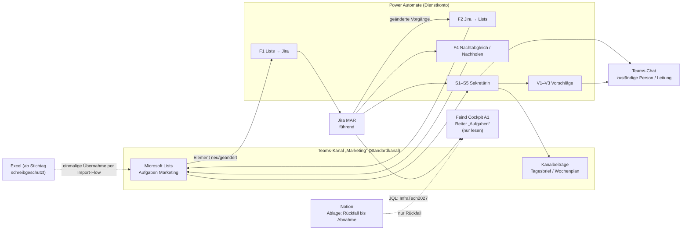

# Spec: Aufgabensteuerung Team Marketing – Microsoft Lists als Oberfläche, Jira MAR als Motor, „Sekretärin“ und Cockpit-Reiter „Aufgaben“

**Stand:** 08.11.2026 · **Status:** Entwurf zur Freigabe durch David · **Herkunft:** Entscheidungs-Session im Feind Cockpit (`cockpit-a1`), Reiter „Aufgaben“, Thread 7cdd254f; Datum der einzelnen Entscheidungen nicht festgehalten [PRÜFEN] · Recherche (Cockpit, Jira, Excel, Plattform, Repo), nur lesend · Jira-Site cloudId `febd5d76-b798-4c5f-8716-85c8a37fbdab`, Projekt MAR (Projekt-ID 10077)

**Leserkreis:** Auftraggeber (im Folgenden „Leitung“; **Annahme:** Rollenbezeichnung „Leitung Marketing & Event“) und umsetzende Agenten. Personen erscheinen nur als Rollen.

**Kennzeichnung:** **Annahme:** = nicht entschieden, aber als Arbeitsgrundlage gesetzt (Kurzliste am Ende von Abschnitt 18). [PRÜFEN] = unbelegt oder nur aus Drittquelle. Rechtliche und Mitbestimmungsfragen: „Bitte Rechtsabteilung prüfen.“

**Funktionen in Umsetzungsreihenfolge**
1. Freigaben und Klärung (Lizenz, Datenschutz, Betriebsrat, Dienstkonto)
2. Jira-Vorbereitung (Komponenten, Label, Abgleich des Altbestands)
3. Cockpit-Reiter „Aufgaben“ liest Jira statt Notion
4. Microsoft Lists im Kanal „Marketing“ anlegen, Excel übernehmen (Stichtag, Rückweg)
5. Abgleich Lists ↔ Jira (Power Automate)
6. Sekretärin: Erinnerungen und Briefe – zuerst im Testmodus, Echtbetrieb erst nach Freigabe
7. Sekretärin: Vorschläge mit Ein-Klick-Freigabe
8. Einführung im Team, Abnahme, Notion-Rückfall entfernen, Excel archivieren, Betrieb übergeben

**Umsetzungsstand:** Noch nichts umgesetzt. Alle Recherchen haben nur gelesen.

---

## 0. Kurz und einfach (für die Leitung)

1. **Was gebaut wird:** Das Team pflegt Aufgaben künftig in einer Microsoft-Liste im Teams-Kanal „Marketing“. Im Hintergrund wird jede Aufgabe automatisch in Jira (Projekt MAR) gespiegelt. Jira bleibt die maßgebliche Quelle, das Team muss Jira aber nicht bedienen.
2. **Die „Sekretärin“:** Ein Automatik-Dienst schreibt Tagesbrief und Wochenplan in den Kanal, erinnert Zuständige im persönlichen Chat an Fristen und meldet Überfälliges an die Leitung. Alles, was Struktur, Zuständigkeit oder Aufgaben anderer verändert, legt sie der Leitung nur als Vorschlag zum Anklicken vor.
3. **Was die IT klären muss, bevor gebaut wird:** Die Jira-Anbindung in Power Automate ist kostenpflichtig (Premium). Dazu kommen ein technisches Konto für die Automatik und eventuell ein Jira-Nutzerplatz dafür. Kosten sind nicht bekannt und werden hier nicht geschätzt.
4. **Was Datenschutz und Betriebsrat freigeben müssen:** Lists zeigt echte Namen, Abwesenheiten und Erinnerungen. Das kann als Leistungs- oder Verhaltenskontrolle gelten. Deshalb startet die Sekretärin im Testmodus (alle Nachrichten nur an die Leitung) und geht erst nach Freigabe in den Echtbetrieb. Bitte Rechtsabteilung prüfen.
5. **Was die Leitung entscheidet:** die Punkte in Abschnitt 18, je mit Empfehlung. Zuerst nötig: Freigabe der Jira-Nachpflege (O19), Liste der Bereiche (O6), Stichtag der Umstellung (O28) und Wechsel der Sekretärin in den Echtbetrieb (O24).

---

## 1. Zweck und Ziel

| Punkt | Inhalt |
|---|---|
| Problem 1 | Jira ist für das Team zu kompliziert und wird als Oberfläche nicht angenommen. |
| Problem 2 | Die Excel-Liste „Aufgabenliste_Team_Marketing_FEIND.xlsx“ hat eine Automatik, die nie gelaufen ist („Letzter Automatik-Lauf: noch nie“). Es gibt zwei voneinander abweichende Fassungen (neu: 51 Aufgaben laut Übersicht, 52 Zeilen; alt: 54 Zeilen). |
| Problem 3 | Die Quellen sind widersprüchlich dokumentiert: README und `datenmodell.md` nennen Notion als führend, Code-Kommentare nennen Jira. Die Entscheidung im Thread 7cdd254f löst das auf: **Jira MAR ist führend.** |
| Ziel | Eine kompakte, leicht bedienbare **Leitungs- und Koordinationsoberfläche** mit Fristen- und Verwaltungssystem. Sie denkt wie eine gute **Sekretärin** mit: erinnert, plant, koordiniert und schlägt Verbesserungen der Struktur vor. |
| Grundsatz | Das Team arbeitet nur in Microsoft Lists im Teams-Kanal „Marketing“. Jira läuft im Hintergrund als Motor für Abgleich und Automatik. Das Cockpit zeigt der Leitung die Messe InfraTech 2027 aus Jira. |

## 2. Entscheidungen

Quelle aller Zeilen außer E15: Entscheidungs-Session Thread 7cdd254f, Stand 08.11.2026; Einzeldatum [PRÜFEN].

| Nr. | Entscheidung | Quelle |
|---|---|---|
| E1 | Jira MAR ist die Hauptquelle. Notion dient nur noch als Ablage. | Leitung |
| E2 | Das Team arbeitet in Microsoft Lists im Teams-Kanal „Marketing“. Jira bleibt als Motor im Hintergrund. | Leitung |
| E3 | Lists darf ab Phase 1 nach Jira schreiben: neue Aufgabe, Status, Fällig, Notiz, Zuständig. | Leitung |
| E4 | Abgleich und Automatik laufen über Power Automate. Lizenz und Premium-Connector klärt die IT. | Leitung |
| E5 | Bei einem Konflikt gewinnt Jira. Die überschriebene Lists-Änderung wird als Kommentar am Element festgehalten. | Leitung |
| E6 | Die Sekretärin erinnert selbstständig: Tagesbrief und Wochenplan als Beitrag im Kanal „Marketing“, Fristen und Überfälliges als Teams-Chat an die zuständige Person, Eskalation an die Leitung. | Leitung |
| E7 | Strukturänderungen, Umverteilen und Neuanlage für andere nur als Vorschlag mit Ein-Klick-Freigabe durch die Leitung. | Leitung |
| E8 | Die Excel-Liste samt ID- und Vertretungsskript wird abgelöst: einmal übernehmen, danach schreibgeschützt archivieren. | Leitung |
| E9 | Lists zeigt intern echte Namen (für Erinnerungen nötig). Datenschutz und Betriebsrat werden vor dem Start eingebunden. Bis zur Freigabe keine Auswertung „Überfälliges je Person“. Bitte Rechtsabteilung prüfen. | Leitung |
| E10 | Der Cockpit-Reiter „Aufgaben“ liest Jira statt Notion, nur InfraTech 2027, Personen nur als Rollen über eine Tabelle Jira-Konto→Rolle im Cockpit. Einzelheiten in Abschnitt 8. | Leitung |
| E11 | Budget kommt nicht aus Jira. Es bleibt im Budget-Reiter bzw. in Excel. | Leitung |
| E12 | Fällt Jira aus, zeigt das Cockpit den letzten Stand aus dem Cockpit-Speicher mit Zeitstempel und Hinweis „nicht aktuell“. | Leitung |
| E13 | Atlassian wird im Cockpit lesend deklariert. Notion bleibt bis zur Abnahme parallel als Rückfall und wird danach entfernt. | Leitung |
| E14 | Die Jira-Nachpflege (Komponenten anlegen, Label `InfraTech2027` setzen) übernimmt Claude nach Freigabe durch die Leitung. | Leitung |
| E15 | Altbestand, der nur in Notion steht, wird einmal mit MAR abgeglichen. Fehlendes kommt als Liste zur Freigabe und wird erst danach angelegt. | **Annahme** (keine Vorliebe genannt); Bestätigung über O33 |
| E16 | SharePoint-Listen im Cockpit kommen erst in Phase 2. | Leitung |
| E17 | Diese Spec wird anschließend mit `to-tickets` in Tickets zerlegt. | Leitung |

## 3. Begriffe

### 3.1 Fachbegriffe der Aufgabensteuerung

| Begriff | Bedeutung |
|---|---|
| Aufgabe / Element | Ein Eintrag in der Lists-Liste. Er entspricht genau einem Jira-Vorgang (Typ Task oder Sub-Task). |
| Vorgang / Schlüssel | Jira-Eintrag mit Schlüssel `MAR-<Nr>`. Der Schlüssel ist die führende ID. |
| Alt-ID | Bisherige Excel-ID `MK-###`, nur als Verweis. |
| Führend / Hoheit | Das System, dessen Wert im Zweifel gilt. Grundsätzlich Jira. |
| Abgleich | Die Automatik-Abläufe, die Lists und Jira gleich halten. |
| Dienstkonto | Technisches Konto, über das die Automatik schreibt. Seine Änderungen lösen keinen Gegen-Abgleich aus. |
| Schleifenschutz | Regeln, die verhindern, dass sich zwei Systeme gegenseitig endlos aktualisieren. |
| Sync-Stand | Verborgene Lists-Spalte: wörtlicher Zeitstempel der letzten Jira-Änderung, die nach Lists übernommen wurde. |
| Letzter Abgleichswert | Verborgene Lists-Spalten mit dem Stand der fünf E3-Felder beim letzten Abgleich. Daran wird feldgenau ein Konflikt erkannt. |
| Konflikt | Dasselbe Feld wurde seit dem letzten Abgleich in Jira **und** in Lists geändert. |
| Statuskategorie | Jiras Oberbegriff für den Status: „Zu erledigen“ (new), „In Arbeit“ (indeterminate), „Fertig“ (done). |
| Komponente | Jira-Feld, das im Cockpit als „Bereich“ erscheint. |
| Phase | Jira-Feld `customfield_10195`. |
| Rolle | Funktion statt Name im Cockpit, z. B. Projektleitung. Unbekannte Konten erscheinen als „Team“. |
| Vertretung | Person, die während einer Abwesenheit die Erinnerungen einer anderen mitbekommt. |
| Tagesbrief / Wochenplan | Automatische Beiträge der Sekretärin im Kanal „Marketing“. |
| Vorschlag | Änderung, die die Sekretärin nicht selbst ausführt, sondern der Leitung als Karte mit Freigabe-Knopf vorlegt. |
| Testmodus | Betriebsart der Sekretärin, in der alle Beiträge und Chats nur an die Leitung gehen. |
| Stichtag T | Tag, an dem Lists die Excel-Liste ablöst (Abschnitt 10). |
| Snapshot | Letzter Stand im Cockpit-Speicher, der bei einem Ausfall angezeigt wird. |
| Notfallstand | Im Cockpit-HTML eingebaute Aufgabenliste `D.TASKS` mit Stand 2026-09-28. |

### 3.2 Technische Wörter in einfachem Deutsch

| Wort | In einem Satz |
|---|---|
| Flow | Ein in Power Automate gebauter Ablauf, der automatisch etwas erledigt, z. B. „wenn neue Aufgabe in Lists, dann lege sie in Jira an“. |
| Trigger / Auslöser | Das Ereignis, das einen Flow startet, z. B. „Element geändert“ oder „jeden Morgen um …“. |
| Trigger-Bedingung | Eine Vorab-Prüfung, die verhindert, dass ein Flow überhaupt startet. |
| Connector | Der fertige Anschluss von Power Automate an einen Dienst (SharePoint, Teams, Jira). |
| Premium | Kostenpflichtige Stufe von Power Automate; der Jira-Connector gehört dazu. |
| Dienstprinzipal | Ein technisches Konto im Microsoft-Verzeichnis (Entra), das keiner Person gehört. |
| Multiplexing | Wenn viele Personen über ein einziges lizenziertes Konto arbeiten; das ist laut Microsoft nicht lizenzkonform. |
| JQL | Die Suchsprache von Jira, z. B. „alle Vorgänge mit Label InfraTech2027“. |
| Transition | Ein erlaubter Statuswechsel in Jira, z. B. von „Zu erledigen“ nach „In Arbeit“. |
| Webhook | Eine Adresse, an die ein System automatisch eine Nachricht schickt, sobald sich etwas ändert. |
| Manifest | Die Liste der Werkzeuge, die das Cockpit benutzen darf; was dort fehlt, wird abgelehnt. |
| Spike | Ein kurzer Vorab-Test, um eine technische Unbekannte zu klären. |
| Paging | Daten in Portionen („Seiten“) abholen statt alles auf einmal. |
| `staleTime` | Zeitraum, in dem das Cockpit gespeicherte Daten noch als frisch ansieht. |
| Alias | Ein zweiter Name für dieselbe Funktion, damit alte Aufrufe weiter funktionieren. |
| Retry / 429 | Automatische Wiederholung, wenn ein Dienst „zu viele Anfragen“ (Fehlercode 429) meldet. |
| Adaptive Card | Eine Teams-Nachricht mit Knöpfen, auf die man direkt klicken kann. |

Hinweis: `GLOSSARY.md` gibt es noch nicht. Diese Begriffe werden erst mit `/domain-modeling` übernommen, nicht vorab angelegt (`docs/agents/domain.md:11`).

## 4. Systemüberblick



| Baustein | Aufgabe | Hoheit |
|---|---|---|
| Microsoft Lists | Oberfläche für das Team: anlegen, Status, Fällig, Notiz, Zuständig | nur über Lists-eigene Felder (Abschnitt 5) |
| Jira MAR | Hauptquelle aller Aufgaben, Motor der Automatik | führend |
| Power Automate | Abgleich, Erinnerungen, Vorschläge | keine eigene Datenhaltung außer Hilfslisten (5.5) |
| Cockpit-Reiter „Aufgaben“ | Leitungssicht auf InfraTech 2027, nur lesend | keine; Snapshot als Notbetrieb |
| Notion | Ablage, bis zur Abnahme Rückfall für das Cockpit | keine |
| Excel | ab Stichtag T schreibgeschütztes Archiv | keine |

## 5. Datenmodell

### 5.1 Felder: Lists ↔ Jira ↔ Cockpit

**Annahme:** Die Lists-Spalten sind aus der Excel-Struktur (`Aufgaben!A5:O5`) abgeleitet. Spaltentypen und Ansichten sind nur aus Drittquellen belegt [PRÜFEN].

Richtung: „L→J“ = Lists schreibt nach Jira, „J→L“ = Jira schreibt nach Lists, „J→C“ = Cockpit liest.

| Lists-Spalte (Typ) | Jira-Feld | Cockpit-Feld | Richtung | Hoheit / Regel |
|---|---|---|---|---|
| Schlüssel (Text, im Formular ausgeblendet) | `key` (MAR-<Nr>) | `id` | J→L, J→C | Jira; wird beim Anlegen zurückgeschrieben. Kontrollkopie siehe unten. |
| Aufgabe (Text, Pflicht) | `summary` | `title` | L→J nur beim Anlegen; danach J→L | Jira |
| Thema (Auswahl) | `labels` über Zuordnungstabelle Thema→Label | – | L→J beim Anlegen; J→L | Jira. **Annahme:** nur vorhandene Labels (z. B. Messe, Print, Event, PR, SocialMedia, sonstiges); Tabelle gibt die Leitung frei (O9). Mehrere Labels am Vorgang: erstes Label in der Reihenfolge der Zuordnungstabelle, sonst „Sonstiges“ (**Annahme**). |
| Unterthema / Projekt (Text) | – (Ausnahme: „InfraTech 2027“ → zusätzlich Label `InfraTech2027`) | – | L→J beim Anlegen | Lists-eigen (**Annahme**) |
| Priorität (Auswahl: Kritisch, Hoch, Mittel, Niedrig) | `priority` | `prio` (**Annahme:** Kritisch→P0, Hoch→P1, Mittel/Niedrig→P2) | L→J beim Anlegen; danach J→L | Jira. Excel-Wert „—“ wird zu Mittel (**Annahme**) |
| Zuständig (Person) | `assignee` über Kontenzuordnung (5.5) | `owner` über Rollentabelle (8.3) | L→J und J→L | Jira (E5). „Team“, „Extern“ und Personen ohne Jira-Konto = nicht zugewiesen (O21) |
| Vertretung (Person) | – | – | nur Lists | Lists-eigen (5.4) |
| Fällig (**nur Datum**, ohne Uhrzeit) | `duedate` | `due` | L→J und J→L | Jira (E5); Zeitzonenregel 7.6 |
| Status (Auswahl) | `status` über Transition (5.2) | `status` über Statuskategorie (8.4) | L→J und J→L | Jira (E5) |
| Erledigt am (Datum, automatisch) | Erledigungsdatum [PRÜFEN: Feldname] | – | J→L | Jira |
| Notiz / Nächster Schritt (mehrzeilig) | Kommentar mit Kennung „[Lists]“ (**Annahme**, O10) | `note` = gekürzte Beschreibung (**Annahme**) | L→J | Lists schreibt, Jira bewahrt auf; kein Rückweg J→L (**Annahme**) |
| Ablage / Link (Hyperlink) | – | – | nur Lists | Lists-eigen (**Annahme**) |
| Übergeordnet (Text, nur Anzeige) | `parent` | – | J→L | Jira |
| Blockiert durch (Text, nur Anzeige) | `issuelinks` Typ Blocks (10000), Richtung „is blocked by“ | `deps` | J→L, J→C | Jira |
| Bereich (Text, nur Anzeige) | Komponente(n) | `cat` | J→L, J→C | Jira. Mehrere Komponenten: erste in alphabetischer Reihenfolge plus Hinweis „+n“ (**Annahme**) |
| – | `customfield_10195` Phase | Phase | J→C | Jira |
| – | `customfield_10015` Startdatum | – | Jira-eigen | Phase 1 nicht in Lists |
| Jira-Link (Hyperlink, nur Anzeige) | Vorgangs-URL | Knopf „In Jira öffnen“ | J→L | – |
| Alt-ID (Text) | – | – | nur Lists | Verweis auf `MK-###` |
| Herkunft (Auswahl: Lists, Jira, Excel-Import) | – | – | Flow | technisch |
| Sync-Stand (**Text**, verborgen) | `updated` (wörtlicher ISO-Wert) | – | J→L | Schleifenschutz; als Text, weil Lists-Datumsspalten Millisekunden und Zeitzone nicht exakt halten |
| Letzter Abgleichswert Status/Fällig/Zuständig (verborgen) | – | – | Flow | feldgenaue Konfliktprüfung (6.5) |
| Schlüssel-Kontrolle (Text, verborgen) | – | – | Flow | Kopie des Schlüssels; weicht sie vom sichtbaren Schlüssel ab, schreibt F1 nichts (6.6) |
| Anlage läuft (Ja/Nein, verborgen) | – | – | Flow | Schutz vor Doppelanlage (6.1) |
| Abgleich-Hinweis (mehrzeilig, nur Anzeige) | – | – | Flow → Lists | Ersatz, falls Kommentare per Flow nicht gehen [PRÜFEN] |
| Geändert / Geändert von (Systemspalten) | – | – | Lists | ersetzt Excel M/N; „Geändert von“ dient dem Schleifenschutz |
| – | Budget | `budget` | – | **nicht** aus Jira (E11); kein Budgetfeld in MAR |

Hinweis: Lists bietet laut Recherche keinen gesicherten Schreibschutz je Spalte [PRÜFEN]. Deshalb werden technische Spalten im Formular ausgeblendet (Formularanpassung per JSON, nur Drittquelle [PRÜFEN]) und zusätzlich über die Kontrollkopie abgesichert.

Nicht im Abgleich:
- Vorgangstypen MT - HR Off (10306), MT - HR Sub (kauf) (10207), MT - HR Sub (gew) (10208). Sie enthalten Personalfelder (u. a. `customfield_10102`, `customfield_10103`, `customfield_10110`, `customfield_11019`, `customfield_11020`, `customfield_10597`, `customfield_11155`).
- Jede Abfrage enthält deshalb `issuetype in (10015, 10017)`.

### 5.2 Statuszuordnung Lists ↔ Jira

Jira-Status in MAR: Zu erledigen (10012), In Arbeit (3), Warten auf Freigabe (10031, nur bei Task), Fertig (10013).

| Lists-Status | Jira-Status | Hinweis |
|---|---|---|
| Offen | Zu erledigen | |
| In Arbeit | In Arbeit | |
| Wartet | Warten auf Freigabe | **Annahme:** Die Begriffe meinen dasselbe; fachlich nicht belegt (O7). Bei Sub-Task gibt es den Status nicht: dort bleibt In Arbeit, Lists zeigt einen Abgleich-Hinweis (**Annahme**). |
| Erledigt | Fertig | „Erledigt am“ wird gesetzt |
| Blockiert | – | **Annahme (Empfehlung):** kein eigener Status. Blockierung wird als Jira-Verknüpfung gepflegt und in „Blockiert durch“ angezeigt (O7). |
| Info | – | **Annahme (Empfehlung):** entfällt. Info-Zeilen aus Excel werden zu Notizen oder nicht übernommen (O7). |

Transitionen:
- werden zur Laufzeit mit „Get list of Transitions“ ermittelt; keine festen Transition-IDs.
- Ist der Zielstatus nicht direkt erreichbar, geht F1 über „In Arbeit“ (höchstens zwei Schritte, **Annahme**).
- Verlangt der Übergang ein Pflichtfeld (z. B. Lösung) oder ist auch der Umweg nicht möglich: Fehlerzweig mit Abgleich-Hinweis, kein Abbruch (6.7).
- In der Abnahme AP5 wird jeder Statuswechsel einzeln für Task und Sub-Task geprüft.

### 5.3 Excel → Lists: Übernahme (einmalig)

Quelle ist die neue Datei N mit 52 Zeilen (MK-001 bis MK-053, MK-045 fehlt). Die alte Datei A wird vorher abgeglichen (O8). Ablauf mit Stichtag und Rückweg: Abschnitt 10.

| Excel-Spalte | Ziel in Lists | Regel |
|---|---|---|
| A ID | Alt-ID | bleibt erhalten; neuer Schlüssel ist MAR-<Nr> nach Anlage in Jira |
| B Thema | Thema | Werte, die nicht in der Stammdaten-Liste stehen (z. B. „Newsletter“ aus den Vorlagen), kommen auf eine Klärliste (O9) |
| C Unterthema | Unterthema / Projekt | 1:1 |
| D Aufgabe | Aufgabe | Pflicht; Zeilen ohne D werden übersprungen |
| E Priorität | Priorität | „—“ wird zu Mittel (**Annahme**) |
| F Verantwortlich | Zuständig | „Extern“ und „Team“ bleiben leer |
| G Vertretung | Vertretung | 1:1 |
| H Fällig bis | Fällig | Excel-Seriennummer → reines Datum (7.6) |
| I Status | Status | Zuordnung nach 5.2 |
| J Erledigt am | – bzw. „Erledigt am (Alt)“ | siehe Ablauf Schritt 4 |
| K Ablage / Link | Ablage / Link | U:-Pfade bleiben Text [PRÜFEN: ob sie als Link funktionieren] |
| L Notiz | Notiz | 1:1, als erster „[Lists]“-Kommentar nach Jira |
| M/N Geändert am/von | – | bleibt im Archiv |
| O Vertretung aktiv | – | Formel; ersetzt durch die Sekretärin (5.4) |

Ablauf:
1. Freigabeliste an die Leitung: alle Excel-Zeilen, dazu mögliche Doppelte in MAR (Titelvergleich).
2. Import **nur per Import-Flow über das Dienstkonto** (nicht per Excel-Import oder Einfügen im Raster), weil sonst F1 je Zeile vor der Freigabe Jira-Vorgänge anlegt. F1 ist während des Imports angehalten.
3. Der Import-Flow arbeitet in Stapeln mit Wartezeit (Grenze Jira-Connector 100 Aufrufe je 60 s) und ist wiederholbar ohne Duplikate: Vor jeder Anlage prüft er über Alt-ID bzw. Schlüssel, ob die Zeile schon übernommen ist.
4. Erledigte Zeilen: **Empfehlung:** nur im archivierten Excel lassen, nicht nach Lists und Jira. Grund: Jira würde beim Schließen das Erledigungsdatum auf den Importtag setzen, F2 würde danach das historische Datum in Lists überschreiben. Alternative: Übernahme mit eigener Spalte „Erledigt am (Alt)“, die vom Abgleich ausgenommen ist (O8).
5. Danach F1 wieder einschalten.

Weitere Blätter:

| Blatt | Behandlung |
|---|---|
| Vorlagen | Messe 13 Schritte, Newsletter 5, Event 6, Social-Post 3. Werden Vorlagen der Sekretärin (V1) und eigene Lists-Liste „Vorlagen“ (**Annahme**). |
| Wiederkehrend | Eigene Lists-Liste. Die eine Beispielzeile ist inaktiv. |
| Abwesenheiten | Lists-Liste mit Person, Von, Bis, Vertretung (optional). Gründe werden ausdrücklich nicht erfasst. Erst nach Freigabe aus O13 nutzen. |
| Einsatzplan (Azubi-Rotation) | Wird nicht übernommen. Die 5 Zeiträume stehen schon als Abwesenheiten (**Annahme**). |
| Log, Archiv, Übersicht, Meine Woche, Anleitung, Stammdaten | Werden nicht übernommen. Versionsverlauf von Lists ersetzt das Log, Ansichten ersetzen „Meine Woche“ und das Archiv. |

Die Backup-CSV der Messe-Aufgaben (68 Datensätze) wird **nicht** automatisch übernommen, weil ihre Freitexte Namen und Vertragsdaten enthalten. Bitte Rechtsabteilung prüfen.

### 5.4 ID- und Vertretungsregel

**ID:**
- Die führende ID ist der Jira-Schlüssel `MAR-<Nr>`. Jira vergibt ihn, nicht Lists und kein Skript.
- Ein neues Lists-Element hat bis zur Rückmeldung von F1 keinen Schlüssel. Die Ansicht zeigt dann „wird angelegt …“.
- `MK-###` bleibt nur als Alt-ID. Es werden keine neuen MK-Nummern vergeben. Damit entfällt auch der Fehler der ID-Vorschau („MK-001“).
- Schlüssel werden nie wiederverwendet. Gelöschte Vorgänge hinterlassen eine Lücke.

**Vertretung:**
- **Erst aktiv nach Freigabe aus O13.** Bis dahin gehen Erinnerungen nur an die zuständige Person bzw. an die Leitung. Bitte Rechtsabteilung prüfen.
- Jede Person hat eine Standard-Vertretung in der Lists-Liste „Stammdaten Team“ (ersetzt `Stammdaten!A:C`). Bei Neuanlage setzt der Flow die Spalte Vertretung (**Annahme**).
- Liegt laut Liste „Abwesenheiten“ ein Abwesenheitszeitraum **zwischen heute und dem Fälligkeitstag**, gilt die Vertretung aus der Abwesenheit, falls eingetragen, sonst die Standard-Vertretung. Fristerinnerungen (S3/S4) gehen dann zusätzlich an die Vertretung.
- **Annahme:** In Excel wurde die optionale Vertretungsspalte D der Abwesenheiten von den Formeln nicht ausgewertet; diese Regel behebt das.
- Jira-`assignee` wird durch eine Vertretung **nicht** geändert.
- Ohne Vertretung (z. B. „Extern“, „Team“) geht die Erinnerung an die Leitung.
- Ohne Zuständig: keine Einzelchats. Die Aufgabe erscheint im Tagesbrief im Abschnitt „ohne Zuständig“, zusätzlich höchstens ein Vorschlag V2 je Element und Woche (**Annahme**). Betrifft bei der Erstbefüllung potenziell viele Vorgänge (in MAR 61 ohne Zuständig, einschließlich HR-Typen und Fertigen).
- **Austritt oder Wechsel:** Die Leitung pflegt „Stammdaten Team“ (Person inaktiv). Die Sekretärin erzeugt dann einen Sammelvorschlag V2 für alle offenen Aufgaben der Person und alle Vertretungsbezüge auf sie. Nicht zustellbare Chats laufen in einen Fehlerzweig mit Meldung an die Leitung.

### 5.5 Zuordnungstabellen und Speicherorte

Alle Tabellen mit Personenbezug liegen **nie** im Repository, in Tickets oder in Teams-Beiträgen. Das Repo und seine Issues sind öffentlich.

| Tabelle | Inhalt | Ort | Pflege | Sichtbar für |
|---|---|---|---|---|
| Kontenzuordnung | Microsoft-Konto → Jira-`accountId` | Lists-Liste „Stammdaten Team“, eigene Spalte (**Annahme**) | Leitung | nur Leitung und Dienstkonto (eigene SharePoint-Berechtigung) [PRÜFEN] |
| Standard-Vertretung | Person → Vertretung | Lists-Liste „Stammdaten Team“ | Leitung | Team |
| Thema → Label | Lists-Thema → Jira-Label | Lists-Liste „Zuordnung Thema“ (**Annahme**) | Leitung | Team |
| Feiertage BB | Datum, Bezeichnung | Lists-Liste „Feiertage BB“ (7.6) | Betriebsrolle (12) | Team |
| Abgleich-Status | Zeitpunkt des letzten erfolgreichen F2-Laufs, letzte Fehler | Lists-Liste „Abgleich-Status“ (**Annahme**) | nur Flows | Leitung, Betriebsrolle |
| Rollentabelle | Jira-`accountId` → Rolle | Cockpit-Speicher `config/jira-rollen` (8.3) | Leitung | alle Cockpit-Betrachter – siehe O22 |
| Cockpit-ID-Zuordnung | alte Cockpit-ID → MAR-Schlüssel | Cockpit-Speicher `config/jira-idmap` (8.5) | Claude nach Freigabe (J5) | Cockpit-Betrachter (kein Personenbezug) |

## 6. Abgleich (Power Automate)

### 6.0 Grundregeln

| Punkt | Festlegung |
|---|---|
| Connectoren | SharePoint (Standard), Teams (Standard), Jira (**Premium**). Lizenz klärt die IT (O1). |
| Umgebung | Power-Platform-Umgebung in der Region Deutschland bzw. EU, Flows in einer Lösung (EU-Datengrenze). [PRÜFEN] mit IT |
| Dienstkonto | Ein Entra-Dienstprinzipal oder technisches Microsoft-Konto besitzt die Flows; dahinter ein technisches Jira-Konto mit API-Token. Ob SharePoint- und Teams-Connector einen Dienstprinzipal als Verbindung unterstützen, ist ungeklärt [PRÜFEN] (O2). Jira-Verbindungen lassen sich nicht teilen. |
| Zugangsdaten | API-Token, Webhook-Adressen (sie enthalten eine Signatur) und `X-Automation-Webhook-Token` gelten als Zugangsdaten. Sie liegen nur in Power-Automate-Verbindungen bzw. Jira Automation, **nie** in Repository, Spec, Tickets oder Teams-Beiträgen. |
| Lizenzrisiko | Teilen sich viele Personen eine Premium-Lizenz über ein Dienstkonto, gilt das als Multiplexing und ist nicht lizenzkonform. Ein Dienstprinzipal mit Premium-Connector braucht eine Process-Lizenz. Das technische Jira-Konto belegt eventuell einen kostenpflichtigen Nutzerplatz [PRÜFEN]. Bitte IT bzw. Lizenzverantwortliche prüfen (O1, O2). |
| Wer baut | Der Agent hat keinen Zugriff auf Power Automate. Er liefert Bauanleitungen; gebaut wird von IT oder Leitung (O27). |
| Bereich | Nur Projekt MAR und `issuetype in (10015, 10017)`. HR-Typen werden nie gelesen oder geschrieben. |
| Beidseitiger Abgleich | Microsoft unterstützt beidseitigen Abgleich nicht von Haus aus; er führt zu Endlosschleifen. Deshalb getrennte Flows mit Schleifenschutz. |
| Grenzen | Jira-Connector 100 Aufrufe je 60 s, SharePoint 600 je 60 s, Flow-bot 25 je 300 s je Verbindung. Ein Flow läuft höchstens 30 Tage. Nach 14 Tagen Dauerfehler wird er abgeschaltet. |
| Zeitzone | Alle zeitgesteuerten Flows in „W. Europe Standard Time“ (7.6). |

### 6.1 F1 – Lists → Jira (Element neu oder geändert)

| Schritt | Inhalt |
|---|---|
| Auslöser | SharePoint „When an item is created or modified“, Liste „Aufgaben Marketing“; Gleichzeitigkeit („Concurrency control“) = 1, damit Läufe nacheinander abgearbeitet werden |
| Trigger-Bedingungen (Schleifenschutz 1) | „Geändert von“ ≠ Dienstkonto **und** „Anlage läuft“ ≠ Ja. **Annahme:** Das Editor-Muster ist gängig, ein offizielles Beispiel fehlt [PRÜFEN]. |
| Kontrollprüfung | Schlüssel gesetzt und ≠ Schlüssel-Kontrolle → nichts schreiben, Schlüssel zurücksetzen, Abgleich-Hinweis, Meldung an Betriebsrolle (6.6) |
| A: Neuanlage | Schlüssel leer → „Anlage läuft“ = Ja (über Dienstkonto). Vor der Anlage per JQL nach einer technischen Kennung suchen (Label `lists-<Element-ID>`, **Annahme**); gibt es den Vorgang schon, nur verknüpfen. Sonst „Create a new issue (V3)“ mit Projekt MAR, Typ Task, `summary`, `duedate`, Kennungs-Label. |
| A: Felder nachziehen | Ob „Create a new issue (V3)“ `assignee`, `priority` und `labels` setzen kann, ist nicht belegt (laut Doku nur einfache Feldtypen) [PRÜFEN]. **Rückfallweg (Standard bis zur Testanlage):** danach `assignee`, `priority` und `labels` per „Edit Issue (V2)“, Notiz per „Add comment (V2)“ als „[Lists] …“. |
| A: Abschluss | Vorgang neu lesen, dann Schlüssel, Schlüssel-Kontrolle, Jira-Link, Sync-Stand, letzte Abgleichswerte setzen und „Anlage läuft“ = Nein (alles über Dienstkonto) |
| B: Änderung | Schlüssel gesetzt → „Get issue by key (V2)“ |
| Konfliktprüfung | feldgenau nach 6.5 |
| Ohne Konflikt | Nur geänderte E3-Felder schreiben: Status per Transition (5.2), Fällig/Zuständig per „Edit Issue (V2)“, neue Notiz per „Add comment (V2)“. Welche Felder geändert wurden, ergibt der Vergleich mit den letzten Abgleichswerten. |
| Nicht erlaubte Felder | Änderungen an Aufgabe, Priorität und Thema nach der Anlage werden nicht übertragen; die Werte gehen auf den Jira-Stand zurück, mit Abgleich-Hinweis „bitte Leitung fragen“. **Annahme**, weil E3 sie nicht nennt (O11). |
| Abschluss B | Nach dem **letzten** Jira-Schritt Vorgang neu lesen (jeder Schritt ändert `updated`), dann Sync-Stand und letzte Abgleichswerte setzen |
| Hinweis | Ein neu geschriebener Vorgang erscheint nicht sofort in Jira-Suchergebnissen. F2 erfasst ihn beim nächsten Lauf; der Sync-Stand verhindert doppelte Verarbeitung. |

### 6.2 F2 – Jira → Lists (geänderte Vorgänge)

Es gibt **keinen** Power-Automate-Trigger „Vorgang geändert“. Zwei Wege:

| Weg | Beschreibung | Bewertung |
|---|---|---|
| **A (Empfohlen)** zeitgesteuert | „Recurrence“ alle N Minuten (N legt O3 fest; technisch mindestens 60 s). „Get list of issues“ mit JQL `project = MAR AND issuetype in (10015, 10017) AND updated >= "<letzter erfolgreicher Lauf minus Puffer>"` [PRÜFEN: ob die Aktion JQL annimmt]. Zeitpunkt des letzten erfolgreichen Laufs steht in „Abgleich-Status“. | Kein offener Endpunkt, kein Jira-Automation-Kontingent. Verzögerung bis N Minuten. Holt nach einem Ausfall alles nach, weil vom letzten Erfolg aus gezählt wird. |
| B Webhook | Jira-Automation-Regel → „Send web request“ → „When an HTTP request is received“ ([PRÜFEN] Premium) oder Teams-Webhook-Trigger ([PRÜFEN] Datenformat, vermutlich nur mit „Anyone“) | Fast Echtzeit. Dafür ein ggf. offener Endpunkt, ungeklärte Automation-Kontingente ab 03.12.2026 [PRÜFEN] und „Daten unterwegs“ außerhalb der Atlassian-Datenresidenz. |

Ablauf von Weg A:

| Schritt | Inhalt |
|---|---|
| 1 | Treffer seitenweise vollständig lesen (nicht „Rest beim nächsten Lauf“). Für jeden Treffer das Lists-Element über den Schlüssel suchen (Spalte Schlüssel indizieren). |
| 2 (Schleifenschutz 2) | `updated` wörtlich gleich Sync-Stand → überspringen (Änderung stammt von F1) |
| 3 (Wettlauf-Schutz) | Element seit dem Sync-Stand in Lists geändert („Geändert“ > Sync-Stand und „Geändert von“ ≠ Dienstkonto)? Dann **nicht** einfach überschreiben, sondern Konfliktbehandlung nach 6.5. So geht keine noch nicht übertragene Lists-Änderung still verloren. |
| 4 | Felder mit Richtung J→L (5.1) über das Dienstkonto schreiben; Sync-Stand und letzte Abgleichswerte setzen |
| 5 | Vorgang ohne Lists-Element: nur anlegen, wenn `statusCategory != Done`; Herkunft „Jira“ |
| 6 | Erfolgreicher Lauf: Zeitpunkt in „Abgleich-Status“ schreiben |

Ein früher vorgesehener dritter Schleifenschutz („letzter Bearbeiter in Jira“) entfällt: Er ließe sich nur über das Änderungsprotokoll prüfen, das höchstens 40 Einträge liefert.

### 6.3 F3 – Erstbefüllung (einmalig)

- Offene MAR-Vorgänge ohne HR-Typen werden in Lists angelegt. Bekannt ist nur: 108 offen **einschließlich HR-Typen** (90 Zu erledigen, 17 In Arbeit, 1 Warten auf Freigabe). Die Anzahl ohne HR-Typen wird vor F3 per JQL ermittelt [PRÜFEN]:
  `project = MAR AND issuetype in (10015, 10017) AND statusCategory != Done`
- **Annahme:** Fertige Vorgänge (129 einschließlich HR-Typen) kommen nicht nach Lists.
- Danach folgt die Excel-Übernahme nach 5.3.
- Manuell ausgelöst, schreibt ein Protokoll, wiederholbar ohne Duplikate (Prüfung über Schlüssel).
- Im Testmodus der Sekretärin (7.0), damit keine Erinnerungswelle entsteht.

### 6.4 F4 – Nachtabgleich und Nachholen

Weg A sieht gelöschte oder verschobene Vorgänge nie, und ein fehlgeschlagener F1-Lauf wird sonst nie wiederholt. Deshalb:

| Teil | Inhalt |
|---|---|
| Auslöser | täglich nachts (Uhrzeit [PRÜFEN]) und zusätzlich stündlich für den Nachholteil (**Annahme**) |
| Schlüsselvergleich | Alle Schlüssel in Lists gegen das vollständige JQL-Ergebnis `project = MAR AND issuetype in (10015, 10017)`. Für jeden fehlenden Schlüssel „Get issue by key“. |
| Gelöscht | Antwort „nicht gefunden“ → Abgleich-Hinweis „in Jira gelöscht“, Element **nicht** löschen, Meldung an die Leitung (Schutz vor Datenverlust) |
| Verschoben | anderes Projekt oder HR-Typ → neuen Schlüssel nur als Hinweis eintragen (bei HR-Typ nicht einmal das), Element nicht weiter abgleichen, Meldung an die Leitung |
| Nachholen | Elemente mit Abgleich-Fehler oder mit „Geändert“ > Sync-Stand und „Geändert von“ ≠ Dienstkonto werden erneut wie in F1 verarbeitet |
| In Lists gelöscht | „When an item is created or modified“ löst beim Löschen nicht aus. Löschen in Lists löscht in Jira **nichts**. Ist der Vorgang in Jira noch offen, legt F4 das Element wieder an mit Hinweis „in Lists gelöscht – in Jira noch offen“; die Leitung erhält Vorschlag V3 „schließen?“. **Empfehlung:** Löschrecht in Lists nur für Leitung und Dienstkonto (O31). |

### 6.5 Konfliktregel „Jira gewinnt“ (feldgenau)

Grundlage: die fünf E3-Felder. Reine Kommentare oder andere Felder in Jira lösen **keinen** Konflikt aus.

1. F1 oder F2 vergleicht je Feld: Jira-Wert gegen letzten Abgleichswert, Lists-Wert gegen letzten Abgleichswert.
2. Nur in Lists geändert → nach Jira schreiben. Nur in Jira geändert → nach Lists schreiben.
3. In beiden geändert → **Konflikt:** Jira-Wert gilt, Lists-Wert wird auf Jira zurückgesetzt.
4. Am Element entsteht ein Kommentar ohne Personenbezug: „Abgleich <Datum Uhrzeit>: Eine Lists-Änderung am Feld <Feld> (<alt> → <neu>) wurde nicht übernommen, weil der Vorgang zwischenzeitlich in Jira geändert wurde. Aktueller Wert: <Wert>.“
   - Lists-Kommentare per Flow nur über SharePoint-HTTP-Aufruf [PRÜFEN]. Ersatz: Spalte „Abgleich-Hinweis“.
5. Ein zusätzlicher Teams-Chat an die ändernde Person ist **nicht** Teil von Phase 1. E6 deckt ihn nicht ab; er braucht eine eigene Freigabe (O23). Bitte Rechtsabteilung prüfen.

### 6.6 Weitere Randfälle

| Fall | Regel |
|---|---|
| Doppelanlage (Element angelegt und sofort erneut bearbeitet, zwei Personen gleichzeitig) | Gleichzeitigkeit 1, Spalte „Anlage läuft“ mit Trigger-Bedingung, Kennungs-Label `lists-<Element-ID>` vor „Create“ (6.1) |
| Schlüssel von Hand geändert | F1 schreibt nichts, setzt den Schlüssel aus der Kontrollkopie zurück, Abgleich-Hinweis, Meldung an Betriebsrolle |
| Massen-Einfügen oder Excel-Import durch Nutzer | Nicht vorgesehen. Übernahme nur per Import-Flow (5.3). Ansonsten greift die Drosselung; Rest über F4. |
| Neues Element mit Unterthema „InfraTech 2027“ | bekommt zusätzlich Label `InfraTech2027` (5.1) |
| Sub-Task ohne Label | Sub-Tasks erben in Jira keine Labels; Cockpit-JQL berücksichtigt Eltern (8.2); die Sekretärin schlägt V3 „Messe-Aufgabe ohne Label“ vor |
| Vorgang mit mehreren Komponenten | Regel in 5.1; Sekretärin meldet solche Vorgänge als V3-Hinweis |

### 6.7 Fehlerbehandlung und Überwachung

| Fall | Reaktion |
|---|---|
| Aktion schlägt fehl (z. B. Pflichtfeld in Jira, Zuordnung fehlt, Transition nicht möglich) | Fehlerzweig („run after failed“): Abgleich-Hinweis am Element, Eintrag in „Abgleich-Status“, Sammelmeldung an Betriebsrolle und Leitung; weitere Elemente laufen weiter. F4 holt nach. |
| „Create a new issue“ scheitert an komplexen Pflichtfeldern | Rückfallweg aus 6.1; sonst Rückfrage an den Jira-Admin |
| Drosselung (429) | Standard-Wiederholung mit Wartezeit, danach Nachholen über F4 |
| Unbekanntes Microsoft- oder Jira-Konto bei Zuständig | Feld nicht schreiben, Hinweis „Zuordnung fehlt“, Meldung an die Leitung |
| Nicht zustellbarer Chat (z. B. Konto deaktiviert) | Meldung an die Leitung, Austrittsregel aus 5.4 |
| Abgleich gestört | **Täglicher** Prüf-Flow: Lief F2 im erwarteten Abstand erfolgreich, hat F1 offene Fehler? Bei Abweichung Alarm an Leitung und Betriebsrolle und Hinweis im Kanal „Abgleich gestört seit …“ (ohne Personenbezug). |
| Flow abgeschaltet (14 Tage Fehler) | wird durch den täglichen Prüf-Flow früh bemerkt |
| Besitzer verlässt das Unternehmen | deshalb Dienstkonto bzw. Dienstprinzipal, kein persönliches Konto |

## 7. Sekretärin-Funktionen

### 7.0 Testmodus und Start

| Punkt | Festlegung |
|---|---|
| Testmodus | Ab Bau gehen **alle** Beiträge (S1, S2) und Chats (S3–S5) nur an die Leitung. Auch F3 und die Excel-Übernahme laufen im Testmodus. |
| Echtbetrieb | Wechsel nur nach Freigabe aus O13 **und** Ein-Klick-Freigabe der Leitung (O24). Der Wechsel ist ein eigener Schritt in AP7. |
| Startdatum | Die Leitung legt es fest (O25). Vorher bekommt sie einmalig eine Altlasten-Liste (u. a. 13 überfällige Excel-Aufgaben laut Übersicht und überfällige MAR-Vorgänge). **Empfehlung:** S4 und S5 gelten nur für Fälligkeiten ab dem Starttag; Altlasten bereinigt die Leitung über die Liste. |
| Lists-Benachrichtigungen | Eigene Lists-Regeln mit Benachrichtigungen werden in Phase 1 nicht angelegt, damit nichts an der Sekretärin vorbei verschickt wird (**Annahme**). |

### 7.1 Automatisch vs. nur mit Freigabe

| Nr. | Funktion | Art | Kanal |
|---|---|---|---|
| S1 | Tagesbrief | automatisch | Beitrag im Kanal „Marketing“ |
| S2 | Wochenplan | automatisch | Beitrag im Kanal „Marketing“ |
| S3 | Fristerinnerung | automatisch | Teams-Chat an Zuständig; nach Freigabe O13 bei Abwesenheit auch an die Vertretung |
| S4 | Überfällig-Erinnerung | automatisch | Teams-Chat an Zuständig bzw. Vertretung |
| S5 | Eskalation | automatisch | Teams-Chat an die Leitung bzw. ihre Vertretung (O26) |
| S6 | Betriebserinnerungen (z. B. Ablauf des Jira-API-Tokens, jährliche Feiertagspflege) | automatisch | Teams-Chat an die Betriebsrolle |
| V1 | Neuanlage für andere (aus Vorlage, wiederkehrend, Vorschlag) | **nur mit Freigabe** | Karte an die Leitung |
| V2 | Umverteilen (Zuständig ändern, z. B. bei Abwesenheit, Austritt oder ohne Zuständig) | **nur mit Freigabe** | Karte an die Leitung |
| V3 | Strukturänderung (Thema, Label, Komponente, Vorlage, Ansicht) und Hinweise (Label fehlt, mehrere Komponenten, in Lists gelöscht) | **nur mit Freigabe** | Karte an die Leitung |

Die Sekretärin ändert **nie** selbstständig Zuständig, Fällig, Status oder Struktur. Sie erinnert nur und schlägt vor.

### 7.2 Zeitpläne

| Nr. | Zeitpunkt | Quelle |
|---|---|---|
| S1 | An Arbeitstagen morgens; Uhrzeit legt O4 fest | – |
| S2 | Wöchentlich. **Annahme:** am ersten Arbeitstag der Woche mit S1. Excel sah „Wochen-Automatik sonntags 03:00“ vor. | Excel-Anleitung |
| S3 | Täglich mit S1; Vorlauf 3 **Arbeitstage** (**Annahme:** Arbeitstage statt Kalendertage) | Excel `Stammdaten!L`: „Erinnerung 3 Tage“ |
| S4 | Täglich mit S1; je Person ein gesammelter Chat je Lauf | **Annahme** |
| S5 | Überfällig seit X Arbeitstagen; X legt O4 fest | – |
| S2-Vorschau | 14 Tage | Excel `Stammdaten!L`: „Vorschau Wochen-Mail 14“ |
| Vorschläge | gesammelt einmal täglich, keine Einzelflut | **Annahme** |

### 7.3 Inhalte

**Tagesbrief (S1)** – im Kanal, ohne Namen bei Überfälligem und Abwesenheit:
- Heute fällig: Aufgabe, Thema, Link (**Annahme:** ohne Zuständig, bis O13 anders entscheidet)
- Neu überfällig seit gestern: nur Aufgabe, Thema, Link – **ohne** Zuständig
- Neu angelegt bzw. erledigt seit gestern
- Blockierte Aufgaben (Jira-Verknüpfung „wird blockiert durch“)
- Abschnitt „ohne Zuständig“
- Offene Vorschläge, die auf die Leitung warten (nur Anzahl)
- Abwesenheiten werden im Kanal **nicht** genannt.

**Wochenplan (S2)**
- Fristen der nächsten 14 Tage, gruppiert nach Thema
- Meilensteine InfraTech 2027 (Label `InfraTech2027`)
- Aufgaben ohne Fällig oder ohne Zuständig
- Keine Abwesenheiten

**Namensbezogenes** (wer ist überfällig, wer vertritt wen) geht nur im persönlichen Chat an die betroffene Person bzw. an die Leitung. Ob die Kanalbeiträge so zulässig sind, klärt O13. Bitte Rechtsabteilung prüfen.

**Grenzen (E9)**
- Keine Kennzahlen je Person: keine Zählung „Überfälliges je Person“, keine Rangliste, keine Quote je Person, bis Datenschutz und Betriebsrat freigeben. Bitte Rechtsabteilung prüfen.
- Zählungen nur gesamt bzw. je Thema.
- Höchstens 20 @-Erwähnungen je Beitrag und etwa 28 KB; größere Listen werden gekürzt mit Link auf die Lists-Ansicht.
- Der Kanal „Marketing“ muss ein **Standardkanal** sein: Posten in private Kanäle wird laut Microsoft-Doku zum Teams-Connector nicht unterstützt (https://learn.microsoft.com/en-us/connectors/teams/).
- Chats gehen gebündelt: eine Nachricht je Person und Lauf (Flow-bot-Grenze 25 je 300 s).

### 7.4 Ein-Klick-Freigabe (V1–V3)

| Punkt | Festlegung |
|---|---|
| Technik | **Annahme (Empfohlen):** „Post adaptive card and wait for a response“ an die Leitung im Chat. Knöpfe „Freigeben“, „Ablehnen“, „Später“. |
| Einmal-Antwort | Eine Karte kann nur einmal beantwortet werden. Danach wird sie per „Update message“ ersetzt, mit Ergebnis und Zeitpunkt. „Später“ erzeugt am nächsten Tag eine **neue** Karte. |
| Laufzeit | Höchstens 30 Tage je Flow. Unbeantwortete Vorschläge verfallen und werden neu gesammelt. |
| Vertretung der Leitung | Ist die Leitung laut „Abwesenheiten“ abwesend, gehen S5 und V1–V3 an eine benannte Vertretung (O26). |
| Alternative | „Create an approval“: Die antwortende Person braucht keine Premium-Lizenz. |
| Ausführung | Der Flow führt genau den freigegebenen Vorschlag aus: Anlage über F1-Logik bzw. Zuständig ändern. Strukturänderungen in Jira (Komponente, Label) macht Claude bzw. der Jira-Admin, nicht der Flow (**Annahme**). |
| Gestaltung | Karten ohne Rot und ohne eigene Farbwerte; Adaptive Cards bieten nur begrenzte Gestaltung (Teams-Darstellung) [PRÜFEN]. |
| Protokoll | Freigaben erzeugen personenbezogene Protokolle (wer, wann). Bitte Rechtsabteilung prüfen. |

Beispiele für Vorschläge (**Annahme**):
- „Messe-Vorlage auf Stichtag X anwenden (13 Schritte)?“
- „Aufgabe MAR-<Nr> ohne Zuständig – an Rolle Y?“
- „Thema ‚Newsletter‘ fehlt in den Stammdaten – aufnehmen?“
- „Wiederkehrende Aufgabe fällig – anlegen?“

### 7.5 Lists-Ansichten und Gestaltung (Feind-CI)

- Ansichten: „Meine Aufgaben“, „Diese Woche“, „Überfällig“ (gesamt, nicht je Person), „Board nach Status“ [PRÜFEN: Board-Ansicht nur aus Drittquellen belegt].
- Farbregeln (bedingte Formatierung, soweit Lists sie zulässt [PRÜFEN]):
  - überfällig: Rot `signal` `#e3000b` nur als Signal, sonst nirgends
  - bald fällig: Fläche Signal-Gelbgrün `#d6e000`, Schrift Anthrazit `#424e4e`
  - keine sonstigen Voreinstellungen von Lists, insbesondere keine Bernstein-, Lila- oder Rosatöne
- Grenze: Lists erlaubt nur eingeschränkte Gestaltung; Schrift und Radien der Feind-CI lassen sich dort nicht durchsetzen (**Annahme**).

### 7.6 Kalender, Feiertage, Zeitzonen

| Punkt | Festlegung |
|---|---|
| Arbeitstag | Montag bis Freitag ohne gesetzliche Feiertage Brandenburg |
| Feiertage | Lists-Liste „Feiertage BB“, jährlich von der Betriebsrolle gepflegt (Erinnerung S6). Brandenburger Besonderheiten (u. a. Reformationstag 31.10.) beachten. |
| An Nicht-Arbeitstagen | kein S1, S3, S4 |
| Fälligkeit auf Nicht-Arbeitstag | Hinweis im Tagesbrief bzw. beim Anlegen (wie die Wochenend-Warnung der Excel-Liste) |
| Zeitzone Flows | „W. Europe Standard Time“ für alle Recurrence-Flows (Sommer- und Winterzeit) |
| Datum | Lists-Spalte Fällig als „Nur Datum“; Jira `duedate` ist reines Datum |
| Umrechnung | Excel-Datums-Seriennummer → Datum; CSV-Zeitstempel `…T12:00:00Z` → Datum in deutscher Zeit (falls die CSV später übernommen wird) |

## 8. Cockpit-Reiter „Aufgaben“: Umbau von Notion auf Jira

### 8.1 Module und Änderungen

Ort: `/home/user/AIassistent/cockpit-a1/`. Zeilenangaben aus der Recherche.

| Stelle | Heute | Neu |
|---|---|---|
| `src/notion-tasks.js` | Notion-Zuordnung, `toProps`, `newTaskProps` | Neues Modul `src/jira-tasks.js`: `issueToTask`, `issuesToTasks`, Status nach Kategorie, Rollen-Zuordnung, `deps` aus Links. `conflicts`/`norm` werden nicht gebraucht, weil das Cockpit nur liest (**Annahme**). |
| `src/app-notion-tasks.js` | CFG Notion, `fetchAll`, `writeNotion`, `createNotion`, `notionWriteMany`, `pushPending` | Neues Modul `src/app-jira-tasks.js`: CFG Atlassian, `fetchAll` per JQL, keine Schreibfunktionen. Notion-Modul bleibt bis zur Abnahme als Rückfall, aber ab J4 ohne Schreiben (`WRITABLE` leer, Abschnitt 10). |
| Öffentliche Namen | `app.notionLinked`, `app.notionLive`, `app.notionWriteMany`, `app.notionTaskStatus` (u. a. HTML:9384, 13840, 13927) | **Annahme:** neue Namen `app.tasksLinked`, `app.tasksLive`, `app.taskStatus`, alte Namen als Alias bis zur Abnahme |
| Schreibpfade | `WRITABLE` = status, note, due, prio, beschluss, archived | entfällt. „Bearbeiten“ wird zu „In Jira öffnen“ bzw. „In Lists öffnen“ (8.7) |
| PDF-Rücklauf | `pdf-return.js` (HTML:3925-3929, 4018), `app-pdf-return.js` (HTML:13838-13897) schreibt nach Notion | **Annahme:** Phase 1 nur Anzeige der Abweichungen mit Link nach Jira (O12) |
| Snapshot | `notion/tasks` | `jira/tasks` mit `{ at, tasks }`; gleiche Regeln (nur geteilter Speicher, nur bei Änderung, höchstens alle 5 Minuten). **Enthält nur Rollen, nie `accountId`, Anzeigename oder E-Mail.** |
| Lokale Aufgaben-Dokumente | `tasks/<id>` | enthalten ebenfalls nie `accountId`, Anzeigename oder E-Mail |
| Schalter | `features.notionTasks` (HTML:5080, 10379) | neu `features.jiraTasks`; `notionTasks` bleibt bis zur Abnahme |
| Notfallstand | `D.TASKS`, Stand 2026-09-28 (HTML:3244-3247) | bleibt, Kommentar angepasst |
| Texte | Statuszeile, Banner, Toasts mit „Notion“ | „Jira“; Banner bei Snapshot: „nicht aktuell – Stand <Zeitstempel>“ |
| Doku | `README.md:15-42`, `kontext/datenmodell.md`, `messe/rotterdam-2027/SYSTEM-UEBERSICHT.md` | auf „Jira führend“ umstellen; neue Pfade (`jira/tasks`, `config/jira-rollen`, `config/jira-idmap`) in `datenmodell.md` eintragen |
| `cockpit-sync` | Ausschlussliste in `.claude/skills/cockpit-sync/SKILL.md:32-35` nennt `tasks`, `settings/*`, `leads/counts`, aber kein `config/*` | `config/jira-rollen`, `config/jira-idmap` und `jira/tasks` in die Ausschlussliste aufnehmen. Bis dahin ist „cockpit-sync schreibt diese Pfade nicht“ nur **Annahme**. |
| Tests | `test/notion-tasks.test.mjs` (8 Tests), `e2e/notion-smoke.mjs`, `test/brennglas.test.mjs`, `e2e/actions-smoke.mjs` | neu `test/jira-tasks.test.mjs` und `e2e/jira-smoke.mjs` mit simuliertem `callTool`; Test auf wortgleiche Einbettung ins HTML auch für die neuen Module; Befehl `npm run test:cockpit-a1` |

### 8.2 JQL-Filter

```
project = MAR
AND issuetype in (10015, 10017)
AND (labels = InfraTech2027 OR parent in (<Vorgänge mit Label InfraTech2027>))
ORDER BY duedate ASC
```

- `parent in (…)` [PRÜFEN: Schreibweise und Unterstützung im Atlassian-Werkzeug]; damit erscheinen Sub-Tasks ohne eigenes Label.
- Es gibt in MAR **keinen Typ Epic**. Gefiltert wird über das Label `InfraTech2027`; heute 18 Vorgänge (MAR-233 bis MAR-250).
- MAR-186 („InfraTech2027 Rotterdam“, Task, In Arbeit, ohne Label) ist faktisch der Sammelvorgang (**Annahme**) und bekommt das Label (J3).
- MAR-185 ist ein HR-Typ und wird durch den Typfilter ausgeschlossen.
- Ob Vorgänge mit `RTM27` bzw. `Messe` ohne `InfraTech2027` dazugehören, ist offen (O5).
- `issuetype in (10015, 10017)` ist Pflicht, damit keine HR-Personalfelder ins Cockpit gelangen.
- Paging: Seitengröße und Paging-Art des Atlassian-Werkzeugs sind unbekannt [PRÜFEN], Klärung im Spike (O18). Die bisherigen Notion-Werte (100 je Seite, höchstens 20 Seiten) gelten nicht automatisch.

### 8.3 Rollen-Tabelle

| Punkt | Festlegung |
|---|---|
| Grundlage | E10: Personen nur als Rollen über eine Tabelle Jira-Konto→Rolle im Cockpit |
| Ort | Cockpit-Speicher `config/jira-rollen` = `{ "<Jira-accountId>": "<Rolle>" }` (**Annahme:** Pfadname). Nie im Repository. |
| Datenschutz | Im Artefakt-Speicher können alle Cockpit-Betrachter die pseudonymen `accountId`s lesen. Das berührt die Regel „keine Daten Dritter in Artefakten“. Deshalb eigener Punkt O22 mit Alternative (Rollen-Label am Vorgang statt Kontentabelle). Bitte Rechtsabteilung prüfen. |
| Pflege | Leitung im Cockpit (Einstellungen) |
| Rollen | aus dem bisherigen Bestand: Marketing & Event, Werkstatt, Geschäftsleitung, Projektleitung, Messeteam. Vollständige Liste `D.ROLES` nicht gefunden [PRÜFEN] |
| Unbekannt / nicht zugewiesen | Anzeige „Team“ |
| Namen | werden **nie** angezeigt, gespeichert oder exportiert. Aus der Jira-Antwort wird nur die `accountId` für die Zuordnung verwendet; Anzeigename und E-Mail werden sofort verworfen. In Snapshot und `tasks/<id>` steht nur die Rolle. |

### 8.4 Statuskategorie und Prioritäten

| Jira-Statuskategorie | Cockpit-Status | Anzeige |
|---|---|---|
| Zu erledigen (new) | offen | Originalname als Hinweis, z. B. „Zu erledigen“ |
| In Arbeit (indeterminate) | in Arbeit | Originalname, z. B. „Warten auf Freigabe“ |
| Fertig (done) | erledigt | Originalname „Fertig“ |

- „blockiert“ wird nicht als Status abgebildet, sondern als Kennzeichen, sobald `deps` offene Vorgänge enthält (**Annahme**).
- „zurückgestellt“ hat keine Entsprechung in Jira und entfällt (**Annahme**).
- Die Schreibweisen der alten Checkliste (`offen|inArbeit|erledigt|zurueckgestellt`) werden nicht übernommen.

### 8.5 Blockiert durch, Bereich, Phase, IDs

| Cockpit | Jira |
|---|---|
| `deps` | `issuelinks` vom Typ Blocks (10000), Richtung inward „is blocked by“, als Liste der Schlüssel. Beispiel heute: MAR-240 blockiert MAR-186. |
| `cat` (Bereich) | Komponente; mehrere: Regel aus 5.1; ohne: „ohne Bereich“ |
| Phase | `customfield_10195`. Heute haben alle Vorgänge „Vorbereitung“ (Option 10261). |
| `id` | Jira-Schlüssel. **Annahme:** Bisherige Cockpit-IDs (s1…x17, `n-<Nr>`) werden über `config/jira-idmap` auf MAR-Schlüssel umgehängt, damit lokale Daten unter `tasks/<id>` (Links, Anhänge, `custom`) erhalten bleiben. |
| Nur-Notion-Aufgaben, deren Anlage die Leitung ablehnt | bleiben lokal als „archiviert (ohne Jira)“ mit Exportweg (CSV) für ihre Links und Anhänge (**Annahme**) |
| `budget` | nicht aus Jira (E11) |
| `beschluss`, `flags`, `archived`, `source` | keine Jira-Felder. **Annahme:** bleiben lokale Cockpit-Felder in `tasks/<id>` (O12) |

### 8.6 Cache, Ausfall, Rückfall

Quellenstufen in dieser Reihenfolge, nie gemischt:
1. Jira live (alle 60 s bei sichtbarer Seite und bei Rückkehr in den Tab, `staleTime` 20 s wie bisher)
2. Snapshot `jira/tasks`, Banner „nicht aktuell – Stand <Zeitstempel>“
3. Notion live, **nur bis zur Abnahme**, Banner „Rückfall Notion – nicht führend – letzte Notion-Änderung <Datum>“. Ab dem Notion-Freeze (Abschnitt 10) zeigt diese Stufe veraltete Daten; sie bleibt nur mit Datum sichtbar.
4. Notfallstand `D.TASKS` (Stand 2026-09-28)

Fehlercodes aus `app.mcpErrText` schalten wie bisher auf die nächste Stufe um.

### 8.7 Deklaration, Bearbeiten, Gestaltung

- Im Manifest beim Veröffentlichen kommt ein Eintrag für den Atlassian-Server hinzu, nur mit Lesewerkzeugen. Werkzeugnamen und Rückgabeform des Connectors im Viewer sind unbekannt [PRÜFEN]. **Annahme:** etwa `searchJiraIssuesUsingJql`.
- Der Notion-Eintrag bleibt bis zur Abnahme. Fehlt ein Werkzeug, lehnt claude.ai mit `not_in_manifest` ab.
- Keine Schreibwerkzeuge für Atlassian im Manifest.
- „Bearbeiten“ wird zu zwei Links: „In Jira öffnen“ (Vorgangs-URL) und „In Lists öffnen“ (in Phase 1 nur die Lists-Ansicht, weil das Cockpit die Element-ID nicht kennt; SharePoint im Cockpit erst Phase 2).
- Livebetrieb des Atlassian-Lesezugriffs erst nach Klärung der Auftragsverarbeitung (O17). Bitte Rechtsabteilung prüfen.
- Oberfläche nach Feind-CI (`branding/feind-ci.tokens.json`, Farbsystem 1.2), Werte nur über Tokens, nie im Markup:
  - Knöpfe: Grün `#84bb20` als Fläche, Schrift `on-accent-strong` `#1f2525`
  - Rot `signal` `#e3000b` nur als Signal für Überfälliges
  - Warnung „bald fällig“: Fläche `#d6e000`, Schrift und Symbol Anthrazit
  - Linktext `accent-text` `#4d7311`
  - Schrift: Display `Exo`, Text `Helvetica Neue / Helvetica / Arial`
  - Radien: Eingaben 2 px, Buttons 4 px
  - Abstände aus der Skala 4 / 8 / 16 / 24 / 40 / 64
  - beide Themes (hell auf `:root`, dunkel über `prefers-color-scheme` und `data-theme`)

## 9. Jira-Vorbereitung

Ausführung durch Claude, erst nach Freigabe durch die Leitung (E14, O19). Jeder Schritt wird zuerst als Liste vorgelegt. Vor J1–J3 wird eine Vorher-Liste der Labels und Komponenten der betroffenen Vorgänge gespeichert (Rückweg, Abschnitt 10) – außerhalb des Repositorys, ohne Personenbezug.

| Nr. | Schritt | Inhalt | Freigabe |
|---|---|---|---|
| J1 | Komponenten anlegen | Heute gibt es keine. Vorschlag aus den Cockpit-Bereichen: Steuerung & Fristen, Dokumente & Ablage, Standbau & Technik, Rotterdam / NL-Spezifika, Logistik & Transport, Leads & CRM. Vollständige Liste `D.CATS` nicht gefunden [PRÜFEN]. | Liste der Namen (O6) |
| J2 | Komponenten zuordnen | je InfraTech-Vorgang **eine** Komponente; Vorschlagsliste Schlüssel → Komponente | Liste |
| J3 | Label `InfraTech2027` ergänzen | MAR-186 sowie ggf. RTM27- und Messe-Vorgänge ohne das Label (O5). Nie bei HR-Typen. | Liste |
| J4 | Altbestand Notion → MAR | Notion-DB „Aufgaben InfraTech 2027“ lesen und mit MAR abgleichen (Titel, Fällig, Bereich). Ergebnis in drei Gruppen: „in beiden“, „nur Notion“, „nur MAR“. Offene Punkte aus dem früheren Abgleich (F2, F3, F4, F6, F7 neu; F1, F5, F8, D1–D3 als Notiz; W4, W5, W7; Frist W8 in Nr 73) werden mitgeprüft. Vorher Notion-Schreiben im Cockpit abschalten (Abschnitt 10). | Freigabeliste „nur Notion“ → erst danach anlegen (O33) |
| J5 | Cockpit-ID-Zuordnung | aus J4: Cockpit-ID → MAR-Schlüssel für `config/jira-idmap` | Liste |
| J6 | Feld Phase | erlaubte Werte prüft der Jira-Admin, weil das Feld in keiner Anlege-Maske steht | Admin (O16) |
| J7 | Technisches Jira-Konto | anlegen, Rechte nur auf MAR, API-Token nur in der Power-Automate-Verbindung; Nutzerplatz-Kosten [PRÜFEN] (O1) | IT / Jira-Admin |

Für F6, F7 und Nr 87 gilt aus dem früheren Abgleich: Bitte Rechtsabteilung prüfen. Die Freigabelisten enthalten keine Namen, sondern Rollen.

## 10. Migration und Rückweg

| Schritt | Inhalt |
|---|---|
| Stichtag T | legt die Leitung fest (O28) |
| Notion-Freeze | ab J4: Cockpit schreibt nicht mehr nach Notion (`WRITABLE` leer, `pushPending` aus). Danach ist Notion nur noch Ablage und Lese-Rückfall. |
| Excel-Freeze | ab T−1: keine Änderungen mehr; der Stand von Datei N wird als Export festgehalten |
| Übernahme | Import-Flow nach 5.3, danach F3 |
| Excel schreibgeschützt | ab T (nicht erst bei der Abnahme), damit es keine Doppelpflege gibt |
| Parallelbetrieb | ab T bis zur Abnahme: Lists und Jira führen, Excel nur lesen, Notion nur Rückfall im Cockpit. Dauer: O20. |
| Abbruchkriterien | legt die Leitung bis T fest (O28), z. B. dauerhafte Abgleich-Fehler oder fehlende Freigabe aus O13 |
| Rückweg Lists | Export der Liste als CSV/Excel im Spaltenschema von Datei N, Excel wieder beschreibbar, Flows aus |
| Rückweg Cockpit | Schalter `jiraTasks` aus, `notionTasks` an (bis zur Abnahme möglich) |
| Rückweg J1–J3 | gespeicherte Vorher-Liste der Labels und Komponenten zurückspielen (nach Freigabe) |
| Entscheidung Rückweg | Leitung (O28) |
| Probe | Der Rückweg wird einmal geübt, bevor Excel schreibgeschützt wird (Abnahme AP9). |

## 11. Datenschutz und Mitbestimmung

| Punkt | Festlegung |
|---|---|
| Personenbezug in Lists | Lists zeigt intern echte Namen (Zuständig, Vertretung) und Abwesenheitszeiträume; Gründe werden nie erfasst. Zugriff nur für Mitglieder des Teams Marketing. Berechtigungen kommen von der SharePoint-Website, nicht von den Teams-Rollen, und müssen geprüft werden [PRÜFEN]. |
| Kanalbeiträge | ohne Namen bei Überfälligem, keine Abwesenheiten (7.3). Zulässigkeit in O13. Bitte Rechtsabteilung prüfen. |
| Vertretungs-Erinnerungen | verraten Abwesenheit; erst nach Freigabe O13 (5.4). Bitte Rechtsabteilung prüfen. |
| Konflikt-Hinweise | Kommentartext ohne Personenbezug; kein automatischer Chat an die ändernde Person ohne Freigabe (O23) |
| Gäste | Gäste können Einträge hinzufügen. **Annahme:** keine Gäste im Kanal „Marketing“ (O14). |
| Keine Leistungsauswertung | keine Auswertung „Überfälliges je Person“, keine Quoten oder Ranglisten je Person, bis Datenschutz und Betriebsrat freigeben (E9) – in Lists-Ansichten, Briefen und Cockpit |
| Betriebsrat | Lists, Erinnerungen, Abwesenheitsliste und Freigabeprotokolle können zur Leistungs- und Verhaltenskontrolle geeignet sein. Einbindung **vor** dem Echtbetrieb. Bitte Rechtsabteilung prüfen. |
| Zuordnungstabellen | Kontenzuordnung (E-Mail bzw. Konto → `accountId`) nur in „Stammdaten Team“ mit Zugriff Leitung/Dienstkonto; Rollentabelle im Cockpit siehe O22 (5.5). Bitte Rechtsabteilung prüfen. |
| Jira-HR-Typen | werden nie gelesen, abgeglichen oder exportiert (Typfilter in jeder Abfrage) |
| Cockpit | nur Rollen, nie Namen. Snapshot und `tasks/<id>` ohne `accountId`, Anzeigename, E-Mail. |
| Auftragsverarbeitung | Weder Atlassian noch Notion stehen im Datenschutzbericht (§ 7.1) als Auftragsverarbeiter; Power Automate und die Verbindung zu Jira kommen hinzu. Blockiert den Livebetrieb von AP3 und AP5. Bitte Rechtsabteilung prüfen (O17). |
| Datenresidenz | Power-Platform-Umgebung EU/Deutschland. Ob die Jira-Site einen Plan ab Standard mit eingerichteter Datenresidenz hat, ist unbekannt [PRÜFEN]. Die Atlassian-Datenresidenz deckt die *Konfiguration* von Automation-Regeln, Daten unterwegs, Caches (bis 30 Tage) und Protokolle nicht ab. Bitte Rechtsabteilung prüfen. |
| Freigabe-Protokolle | Karten und Approvals speichern, wer wann geantwortet hat. Bitte Rechtsabteilung prüfen. |
| Excel-Inhalte | Stammdaten enthalten eine geschäftliche E-Mail-Adresse (Zelle B5). Die Backup-CSV der Messe-Aufgaben enthält Namen und Vertragsdaten in Freitexten und wird **nicht** automatisch übernommen. Bitte Rechtsabteilung prüfen. |
| Repository / Issues | Das Repo ist öffentlich. Keine Namen, `accountId`s, E-Mails, Zuordnungstabellen, Tokens oder Webhook-Adressen in Repo, Spec oder Tickets. |
| Löschkonzept | Fristen je Datenart [PRÜFEN]: erledigte Lists-Elemente (Excel hatte 60 Tage bis zur Archivierung), Abwesenheiten (**Annahme:** Löschung nach Ende des Zeitraums plus Frist), Kommentare und Abgleich-Hinweise, Flow-Laufprotokolle, Freigabe-Protokolle, Snapshot `jira/tasks`, archivierte Excel-Datei. Festlegung mit Datenschutz (O13). Bitte Rechtsabteilung prüfen. |

## 12. Betrieb

| Punkt | Festlegung |
|---|---|
| Betriebsrolle | eine benannte Rolle mit Vertretung (O29); **Annahme:** IT oder Leitung |
| Aufgaben | Prüf-Flow-Alarme bearbeiten, Abgleich-Hinweise abarbeiten, Zuordnungstabellen pflegen (Konten, Rollen, Thema→Label, Feiertage), Jira-API-Token vor Ablauf erneuern, Lizenzen im Blick behalten |
| Prüfrhythmus | täglicher automatischer Prüf-Flow (6.7); manuelle Durchsicht der offenen Abgleich-Hinweise in einem Rhythmus nach O29 |
| Erinnerungen | Token-Ablauf und Feiertagspflege als S6 an die Betriebsrolle |
| Eskalation | Betriebsrolle → Leitung → IT |
| Laufprotokolle | Aufbewahrung nach Löschkonzept (11) |

## 13. Einführung im Team

| Punkt | Festlegung |
|---|---|
| Kurzanleitung | als Registerkarte im Kanal „Marketing“ bzw. Seite an der Liste: anlegen, Status ändern, Notiz, was die Sekretärin tut, was nicht (keine Namen) |
| Einweisung | kurze gemeinsame Einweisung vor T; Dauer legt die Leitung fest |
| Ansprechrolle | Betriebsrolle bzw. Leitung |
| Pilot | **Annahme:** eine Pilotperson aus dem Team testet im Testmodus vor T |
| Messung des Ziels | Abnahme AP10: jedes Teammitglied hat ein Element angelegt und einen Status geändert |

## 14. Nicht-Ziele und Phase 2

| Thema | Status |
|---|---|
| SharePoint-Listen im Cockpit (direkter Lists-Link je Element, Team-Aufgaben außerhalb InfraTech) | Phase 2 (E16) |
| Budget aus Jira | nicht vorgesehen (E11) |
| Vollautomatik (Sekretärin ändert selbst Zuständig, Fristen oder Struktur) | nicht vorgesehen (E7) |
| Schreiben aus dem Cockpit nach Jira | nicht in Phase 1 |
| Auswertungen je Person | erst nach Freigabe (E9) |
| Kalender-Sync | nicht in Phase 1 (war in Excel „nicht aktiv“) |
| Notion als Quelle | nach der Abnahme entfernt; Notion bleibt Ablage |
| Webhook-Echtzeitabgleich (Weg B) | nur falls Weg A nicht genügt |
| Chat an Person bei Konflikt | nur nach Freigabe O23 |

## 15. Umsetzungsphasen

**Phase 1** = AP0 bis AP10. **Phase 2** = Abschnitt 14 (insbesondere SharePoint-Listen im Cockpit).

Dauern und Termine: keine belegten Werte. Die Leitung setzt je Paket einen Zieltermin, ausgerichtet am Messetermin InfraTech 2027 [PRÜFEN] (O32). Größen grob (S/M/L), genauer bei `to-tickets` [PRÜFEN].

| Nr. | Paket | Verantwortlich (Rolle) | Größe | Abhängig von | Zieltermin | Abnahme |
|---|---|---|---|---|---|---|
| AP0 | Freigaben: Lizenz/Premium, Jira-Nutzerplatz, Dienstkonto, Umgebung, Kanaltyp, Datenschutz, Betriebsrat, Auftragsverarbeitung, Bauverantwortung | Leitung; IT; Datenschutz; Rechtsabteilung | M [PRÜFEN] | – | O32 | 16 / AP0 |
| AP1 | Jira-Vorbereitung J1–J5 (einschließlich Notion-Freeze vor J4) | Claude (nach Freigabe Leitung) | S | O19; J4-Inhalte: Datenschutz | O32 | 16 / AP1 |
| AP2 | Technisches Jira-Konto, Feld Phase (J6, J7) | Jira-Admin / IT | S | AP0 | O32 | 16 / AP2 |
| AP3 | Cockpit-Reiter auf Jira (8.1–8.7), Tests, Doku, `cockpit-sync`-Ausschluss | Agent (Code) | L | AP1; Livebetrieb zusätzlich O17 | O32 | 16 / AP3 |
| AP4 | Lists anlegen (Aufgaben, Stammdaten Team, Abwesenheiten, Vorlagen, Wiederkehrend, Zuordnung Thema, Feiertage BB, Abgleich-Status), Ansichten, Berechtigungen, Löschrecht | Leitung mit Agent-Anleitung; IT für Berechtigungen | M | AP0 | O32 | 16 / AP4 |
| AP5 | F1, F2, F4 und Prüf-Flow bauen, Schleifenschutz, Fehlerzweige | Bauverantwortliche Rolle nach O27, Anleitung durch Agent | L | AP0, AP2, AP4 | O32 | 16 / AP5 |
| AP6 | Stichtag, Freezes, Import-Flow, F3 Erstbefüllung, Excel-Übernahme (Freigabeliste) | wie AP5; Freigabe Leitung | M | AP5, O28 | O32 | 16 / AP6 |
| AP7 | Sekretärin S1–S6 im Testmodus; Wechsel in den Echtbetrieb als eigener Freigabeschritt | wie AP5; Freigabe Leitung (O24) | M | AP5; Echtbetrieb: O13, O24, O25 | O32 | 16 / AP7 |
| AP8 | Vorschläge V1–V3 mit Ein-Klick-Freigabe | wie AP5 | M | AP7 | O32 | 16 / AP8 |
| AP9 | Parallelbetrieb, Rückweg-Probe, Abnahme, Notion-Rückfall entfernen, Excel archivieren | Leitung; Agent | S | AP3, AP6, AP7, AP8 | O32 | 16 / AP9 |
| AP10 | Einführung im Team (13), Betrieb übergeben (12) | Leitung; Betriebsrolle | S | AP6, AP7 | O32 | 16 / AP10 |

Für alle Pakete gilt:
- Feind-CI für jede Oberfläche (8.7, 7.5)
- Cockpit-Speicher wird nicht überschrieben, nur ergänzt
- neue Pfade nur zusammen mit `datenmodell.md`
- Code-Änderungen am Cockpit gehen immer auch ins HTML (Test auf Wortgleichheit)
- keine Zugangsdaten und keine Personendaten in Repo, Spec oder Tickets

## 16. Abnahmekriterien

**AP0**
- Schriftliche Aussage der IT zu Lizenzmodell, Jira-Nutzerplatz und Dienstkonto liegt vor, einschließlich Multiplexing-Prüfung und Aussage, ob SharePoint- und Teams-Connector mit Dienstprinzipal laufen.
- Region der Umgebung ist bestätigt; Kanal „Marketing“ ist als Standardkanal bestätigt.
- Datenschutz und Betriebsrat haben schriftlich zugestimmt oder Auflagen genannt; Auftragsverarbeitung (O17) ist geklärt.
- Bauverantwortliche Rolle für Power Automate ist benannt (O27).

**AP1**
- Freigegebene Komponenten existieren in MAR; Vorher-Liste ist gespeichert.
- Alle freigegebenen Vorgänge tragen `InfraTech2027`, darunter MAR-186.
- Kein HR-Vorgang wurde geändert (JQL-Gegenprobe).
- Das Cockpit schreibt nicht mehr nach Notion (Test: Statusänderung im Cockpit erzeugt keinen Notion-Aufruf).
- Die Freigabeliste „nur Notion“ wurde von der Leitung abgezeichnet; angelegt wurde nur, was freigegeben ist.

**AP2**
- Das technische Konto kann in MAR Vorgänge anlegen, ändern und transitionieren und sieht keine anderen Projekte [PRÜFEN].
- Die erlaubten Werte von Phase sind dokumentiert.

**AP3**
- Das Cockpit zeigt genau die Treffer der JQL aus 8.2: Anzahl identisch mit Jira.
- Test mit simulierter Jira-Antwort, die `displayName` und `emailAddress` enthält: beide fehlen im Snapshot `jira/tasks`, in `tasks/<id>`, im DOM und im PDF; `accountId` fehlt in Snapshot und `tasks/<id>`.
- Unbekannte Konten erscheinen als „Team“.
- Status nach Kategorie mit Originalname als Hinweis.
- `deps` stimmt mit den Jira-Verknüpfungen überein (Stichprobe MAR-186 ← MAR-240).
- Bei abgeschaltetem Connector: Snapshot mit Zeitstempel und „nicht aktuell“, danach Notion-Rückfall mit Datum, danach Notfallstand, nie gemischt.
- Keine Schreibaufrufe an Atlassian; das Manifest enthält nur Lesewerkzeuge.
- `npm run test:cockpit-a1` und `node cockpit-a1/e2e/jira-smoke.mjs` sind grün.
- README und `datenmodell.md` nennen Jira als führend; neue Pfade stehen in `datenmodell.md` und in der `cockpit-sync`-Ausschlussliste.
- CI-Prüfung bestanden (beide Themes, keine harten Farbwerte, Schrift, Radien, Abstände).

**AP4**
- Spalten laut 5.1 vorhanden, Fällig als „Nur Datum“, technische Spalten im Formular ausgeblendet.
- Ansichten „Meine Aufgaben“, „Diese Woche“, „Überfällig“ (gesamt), „Board nach Status“ [PRÜFEN].
- Nur Teammitglieder haben Zugriff; „Stammdaten Team“-Kontenspalte nur für Leitung und Dienstkonto; Löschrecht nach O31 (SharePoint-Berechtigungen geprüft).
- Mobil: In der Teams-App (iOS und Android) lassen sich Status und Fällig eines Elements ändern; die Änderung erscheint in Jira (nach AP5).
- Farbregeln nach 7.5, keine ausgeschlossenen Farben.

**AP5** (Abstand N aus O3 als Prüfwert)
- Lists-Neuanlage erzeugt genau einen Jira-Vorgang mit Schlüssel in Lists; Probe: Element anlegen und sofort erneut bearbeiten → kein zweiter Vorgang.
- Status-, Fällig-, Zuständig- und Notiz-Änderung erscheinen in Jira; jeder Statuswechsel einzeln für Task und Sub-Task geprüft.
- Eine Jira-Änderung erscheint innerhalb von N Minuten (plus Laufzeit) in Lists.
- Konfliktprobe: dasselbe Feld gleichzeitig geändert → Jira-Wert in Lists plus Kommentar bzw. Abgleich-Hinweis ohne Personenbezug. Gegenprobe: nur Kommentar in Jira plus Statusänderung in Lists → Status wird übernommen, kein Konflikt.
- Wettlaufprobe: Lists-Änderung zwischen zwei F2-Läufen geht nicht still verloren.
- Schleifenprobe: eine Änderung erzeugt je Richtung genau einen wirksamen Lauf, kein Ping-Pong über 24 h (Laufprotokoll).
- Ausfallprobe: Jira-Verbindung künstlich für 1 h gesperrt; danach sind alle Änderungen beider Richtungen übertragen.
- Fehlerprobe: unbekanntes Konto → Hinweis und Meldung, ohne Abbruch weiterer Elemente.
- Schlüsselprobe: Schlüssel von Hand geändert → in Jira wird nichts geschrieben, Schlüssel wird zurückgesetzt.
- Löschproben: Vorgang in Jira gelöscht → Hinweis, Element bleibt; Element in Lists gelöscht → Jira unverändert, Wiederanlage mit Hinweis und Vorschlag.
- Fertige Vorgänge ohne Element: Änderung an einem fertigen Vorgang legt kein Lists-Element an.
- HR-Negativtest: HR-Vorgang im Zeitfenster geändert → kein Lists-Element, kein Lesen der Personalfelder.
- Zeitzonenprobe: Fälligkeit 01.11. bleibt in Lists, Jira und Cockpit der 01.11., auch über eine Zeitumstellung.
- Prüf-Flow meldet einen künstlich gestoppten F2 am selben Tag.

**AP6**
- Alle 52 Excel-Zeilen sind übernommen oder begründet ausgeschlossen (Freigabeliste); Alt-ID gefüllt.
- Wiederholungslauf des Import-Flows erzeugt keine Duplikate.
- Lists enthält genau die Treffer von `project = MAR AND issuetype in (10015, 10017) AND statusCategory != Done` plus die Schlüssel der Excel-Importe (falls erledigte Zeilen nach O8 übernommen werden, auch diese).
- Excel ist ab T schreibgeschützt; F1 war während des Imports angehalten.

**AP7**
- Im Testmodus erscheinen Tagesbrief, Wochenplan und alle Chats nur bei der Leitung, eine Woche lang zur nach O4 festgelegten Zeit.
- Der Wechsel in den Echtbetrieb erfolgte erst nach O13 und per Ein-Klick-Freigabe der Leitung (O24).
- Fristerinnerung 3 Arbeitstage vorher und Überfällig-Chat gehen nur an Zuständig bzw. (nach O13) Vertretung; keine personenbezogene Zählung und keine Namen bei Überfälligem im Kanal.
- Element ohne Zuständig: kein Einzelchat, Eintrag im Abschnitt „ohne Zuständig“.
- Abwesenheit, die zwischen heute und Fälligkeit liegt, führt zur Erinnerung an die Vertretung (nach O13).
- Austritt mit Testkonto: Sammelvorschlag V2 entsteht; unzustellbarer Chat wird gemeldet.
- Feiertagsprobe mit Stichtag 31.10.: kein S1/S3/S4; Fälligkeit an einem Nicht-Arbeitstag erzeugt Hinweis.
- Eskalation erreicht die Leitung bzw. ihre Vertretung.
- Nach dem Start keine S4/S5 für Fälligkeiten vor dem Starttag (falls O25 so entschieden).

**AP8**
- Ein Vorschlag erzeugt eine Karte an die Leitung (bei Abwesenheit an die Vertretung).
- „Freigeben“ führt genau diese Änderung aus, „Ablehnen“ nichts, „Später“ erzeugt eine neue Karte.
- Die Karte wird nach der Antwort ersetzt.
- Jira-Änderungsprotokoll und Lists-Versionsverlauf über einen Prüfzeitraum [PRÜFEN] zeigen keine Änderung durch das Dienstkonto ohne zugehörige Nutzeränderung oder Freigabe.

**AP9**
- Parallelbetrieb über die nach O20 festgelegte Dauer; am Ende keine offenen Abgleich-Hinweise, die älter als die nach O29 festgelegte Bearbeitungsfrist sind.
- Rückweg einmal geübt (Lists-Export im N-Schema, Cockpit-Schalter), bevor Excel endgültig archiviert wird.
- Notion-Werkzeuge und -Module sind aus dem Cockpit entfernt, Tests angepasst.
- Excel-Datei ist schreibgeschützt archiviert; die Anleitung verweist auf Lists.

**AP10**
- Jedes Teammitglied hat ein Element angelegt und einen Status geändert.
- Kurzanleitung ist im Kanal erreichbar; Betriebsrolle und Vertretung sind benannt.

## 17. Risiken und Gegenmaßnahmen

| Risiko | Folge | Gegenmaßnahme |
|---|---|---|
| Jira-Connector Premium, Dienstkonto ggf. Multiplexing, Jira-Nutzerplatz | Kosten oder nicht lizenzkonformer Betrieb | AP0 vor jedem Bau; Lizenzmodell nach IT-Vorgabe |
| Connectoren unterstützen Dienstprinzipal nicht [PRÜFEN] | Dienstkonto-Konzept trägt nicht | Klärung in O2 vor AP5 |
| Kein Trigger „Vorgang geändert“ | Verzögerung bzw. verpasste Änderungen | Zeitfenster ab letztem erfolgreichem Lauf; F4 als Netz |
| Endlosschleife F1 ↔ F2 | Drosselung, Abschaltung, falsche Daten | Editor-Bedingung, wörtlicher Sync-Stand als Text, Neu-Lesen nach letztem Schritt; 24-h-Schleifenprobe |
| Stille Überschreibung von Lists-Änderungen | Verstoß gegen E5, Datenverlust | Wettlauf-Schutz in F2, feldgenaue Konfliktprüfung |
| Doppelanlage | doppelte Vorgänge | Gleichzeitigkeit 1, „Anlage läuft“, Kennungs-Label |
| „Create a new issue“ kann nur einfache Felder | Anlage unvollständig | Rückfallweg mit „Edit Issue“; Testanlage in AP5 |
| HR-Personalfelder in MAR | Datenschutzverstoß | Typfilter in jeder Abfrage, Negativtest |
| Kein Epic, Messe nur über Label | fehlende Vorgänge im Cockpit | J3, Eltern-Regel in der JQL, V3-Hinweis; O5 |
| Statuswerte passen nicht 1:1 | Verwirrung, Abgleich-Fehler | 4 Lists-Status (O7), Umweg über In Arbeit, Fehlerzweig |
| Lists-Kommentar per Flow nicht möglich [PRÜFEN] | E5 nicht wie beschlossen umsetzbar | Spalte „Abgleich-Hinweis“ |
| Kein Spaltenschutz in Lists [PRÜFEN] | falscher Vorgang wird geändert | Formular ausblenden, Kontrollkopie des Schlüssels |
| Erinnerungswelle nach Erstbefüllung | Unmut im Team, Mitbestimmungsproblem | Testmodus, Startdatum, Altlasten-Liste (7.0) |
| Kanalbeiträge zeigen Überfälliges je Person | Verstoß gegen E9, Mitbestimmung | keine Namen bei Überfälligem, keine Abwesenheiten im Kanal; O13 |
| Rollentabelle mit `accountId` im Cockpit-Speicher | Daten Dritter im Artefakt | O22, Rechtsabteilung; Snapshot nur mit Rollen |
| Zeitzonen / Datumsverschiebung | Fälligkeit um einen Tag falsch | „Nur Datum“, feste Zeitzone, Zeitzonenprobe |
| Cockpit-IDs ändern sich | lokale Links und Anhänge gehen verloren | `config/jira-idmap` (J5), Regel für abgelehnte Nur-Notion-Aufgaben |
| Atlassian-Connector im Viewer unbekannt | Cockpit-Umbau blockiert | früher Spike in AP3 (O18); Notion-Rückfall bleibt |
| PDF-Rücklauf schreibt nach Notion | Schreiben in nicht mehr führende Quelle | Notion-Freeze ab J4; O12 |
| Zwei Excel-Fassungen (N/A) | doppelte oder veraltete Aufgaben | Abgleich N ↔ A vor der Übernahme (O8) |
| Doppelpflege Excel/Lists | widersprüchliche Stände | Excel schreibgeschützt ab T (Abschnitt 10) |
| Jira-Automation-Kontingente ab 03.12.2026 unklar [PRÜFEN] | Kosten bei Weg B | Weg A; Nutzung im Jira-Admin unter „Usage“ prüfen |
| Teams-Grenzen (25 Flow-bot-Aufrufe je 300 s, 28 KB, 20 Erwähnungen) | abgebrochene Briefe | bündeln je Person, kürzen mit Link |
| Flow wird nach 14 Tagen Fehler abgeschaltet | Sekretärin verstummt | täglicher Prüf-Flow mit Alarm |
| Niemand betreut den Betrieb | Fehler und abgelaufene Tokens bleiben liegen | Betriebsrolle (12), S6-Erinnerungen |
| Leitung abwesend | Karten verfallen, Eskalationen ins Leere | Vertretung der Leitung (O26) |
| Betriebsrat stimmt nicht oder spät zu | Echtbetrieb verzögert | AP0 früh beginnen; Testmodus und AP3 laufen unabhängig (AP3-Livebetrieb nur mit O17) |
| Widerspruch `accent-text` (`#5e8a14` in `feind-marketing-cockpit/CLAUDE.md:68` vs. `#4d7311` im Root) | falsche Textfarbe | Root-Regel gilt (`#4d7311`); O15 |

## 18. Offene Punkte und benötigte Freigaben

„Bis wann“ ist aus den Abhängigkeiten abgeleitet; Kalendertermine setzt die Leitung (O32).

| Nr. | Frage | Empfehlung (Grund) | Wer | Wirkung | Bis wann |
|---|---|---|---|---|---|
| O1 | Lizenz: Power Automate Premium oder Process für Flows mit Jira-Connector? Jira-Nutzerplatz für das technische Konto? Kosten? | IT klärt schriftlich vor jedem Bau (Kosten und Lizenzkonformität sind unbekannt) | IT / Lizenzverantwortliche | blockiert AP5–AP8 | vor AP5 |
| O2 | Dienstkonto: Entra-Dienstprinzipal oder technisches Konto? Unterstützen SharePoint- und Teams-Connector einen Dienstprinzipal [PRÜFEN]? Multiplexing-Prüfung | Dienstprinzipal, falls alle Connectoren ihn unterstützen (Microsoft-Empfehlung, unabhängig von Personen) | IT | blockiert AP5 | vor AP5 |
| O3 | Weg A (zeitgesteuert) oder B (Webhook) für Jira → Lists; Abstand N in Minuten | Weg A (kein offener Endpunkt, keine Automation-Kosten); N legt die Leitung mit IT fest | Leitung mit IT | AP5 | vor AP5 |
| O4 | Uhrzeit Tagesbrief, Tag/Uhrzeit Wochenplan, Eskalationsschwelle X Arbeitstage | Tagesbrief vor üblichem Arbeitsbeginn, Wochenplan mit dem ersten Tagesbrief der Woche (Woche beginnt mit Überblick); Schwelle nach Leitung | Leitung | AP7 | vor AP7 |
| O5 | Gehören RTM27- und Messe-Vorgänge ohne `InfraTech2027` zur Messe InfraTech 2027? | Liste dieser Vorgänge vorlegen und einzeln entscheiden (Labels überschneiden sich teilweise, pauschal wäre fehleranfällig) | Leitung | J3, Cockpit-Filter | vor AP1 |
| O6 | Liste der Komponenten (Bereiche) bestätigen | die sechs bekannten Cockpit-Bereiche übernehmen, Rest nach `D.CATS`-Suche ergänzen (bestehende Begriffe) | Leitung | J1 | vor AP1 |
| O7 | Lists-Status auf Offen, In Arbeit, Wartet, Erledigt reduzieren; Wartet = „Warten auf Freigabe“? Blockiert über Verknüpfung; Info entfällt? | ja, vier Status (passt 1:1 zu Jira, weniger Abgleich-Fehler) | Leitung | 5.2, AP4 | vor AP4 |
| O8 | Excel-Übernahme: nur Datei N oder mit Abgleich A? Erledigte Zeilen übernehmen? | N mit Abgleich gegen A; erledigte Zeilen nur im Archiv (historisches Datum bleibt erhalten) | Leitung | AP6 | vor AP6 |
| O9 | Thema→Label-Zuordnung freigeben; Thema „Newsletter“ aufnehmen? | Zuordnung nur auf vorhandene Labels; Newsletter aufnehmen (steht schon in den Vorlagen) | Leitung | 5.1, AP6 | vor AP4 |
| O10 | Notiz als Jira-Kommentar? Cockpit-`note` aus der Beschreibung? | ja, Kommentar mit „[Lists]“ (Verlauf bleibt erhalten, Beschreibung unberührt) | Leitung | 5.1, AP5, AP3 | vor AP5 |
| O11 | Priorität, Aufgabe und Thema nach der Anlage aus Lists änderbar? | nein in Phase 1 (E3 nennt sie nicht; weniger Konflikte) | Leitung | F1 | vor AP5 |
| O12 | PDF-Rücklauf und Cockpit-Felder Beschluss, Hinweis, Archiviert: lokal behalten, abschalten oder nach Jira? | lokal behalten; PDF-Rücklauf nur als Anzeige mit Jira-Link (Cockpit bleibt rein lesend) | Leitung | AP3 | vor AP3 |
| O13 | Zustimmung Datenschutz und Betriebsrat: Lists mit Namen, Abwesenheitsliste, Vertretungs-Erinnerungen, Kanalbeiträge (Inhalt nach 7.3), Erinnerungs-Chats, Freigabe-Protokolle, Kontenzuordnung; Löschfristen | Unterlage mit dieser Spec vorlegen; bis zur Freigabe nur Testmodus. Bitte Rechtsabteilung prüfen. | Datenschutz; Betriebsrat; Rechtsabteilung | blockiert Echtbetrieb AP7–AP8 und Vertretungsregel | vor Echtbetrieb AP7 |
| O14 | Gäste im Kanal „Marketing“? Standardkanal bestätigt? | keine Gäste (Gäste dürfen Einträge hinzufügen, Namen und Fristen würden nach außen sichtbar) | Leitung / IT | AP4, AP7 | vor AP4 |
| O15 | `accent-text` in `feind-marketing-cockpit/CLAUDE.md:68` auf `#4d7311` korrigieren | korrigieren (Root-CLAUDE.md und Farbsystem haben Vorrang) | Leitung (Freigabe), Agent | CI-Konsistenz | vor AP3 |
| O16 | Erlaubte Werte des Felds Phase (`customfield_10195`) | Jira-Admin liest die Feldkonfiguration aus (anders nicht abrufbar) | Jira-Admin | Cockpit-Anzeige | vor AP3 |
| O17 | Auftragsverarbeitung Atlassian, Notion, Power Automate im Datenschutzbericht ergänzen | vor Livebetrieb von AP3 und AP5 klären. Bitte Rechtsabteilung prüfen. | Datenschutz; Rechtsabteilung | blockiert Livebetrieb AP3, AP5 | vor Livebetrieb AP3 |
| O18 | Werkzeugnamen, Rückgabeform und Paging des Atlassian-Connectors im Cockpit-Viewer | Spike zu Beginn von AP3 (größte technische Unbekannte im Cockpit) | Agent (Spike) | AP3 | Beginn AP3 |
| O19 | Freigabe für J1–J5 (Claude schreibt in Jira) | freigeben, jeweils nach Vorlage der Liste (E14) | Leitung | AP1 | vor AP1 |
| O20 | Dauer des Parallelbetriebs vor der Abnahme | festlegen mit mindestens einem vollen Wochenzyklus der Sekretärin (Wochenplan muss einmal gelaufen sein) | Leitung | AP9 | vor AP6 |
| O21 | Hat jedes Teammitglied ein Jira-Konto bzw. eine Jira-Lizenz? Bekannt sind 6 zuständige Konten. | klären; ohne Konto bleibt Zuständig nur in Lists, Jira-`assignee` leer (keine Zusatzkosten) | Leitung / IT | 5.1, AP5 | vor AP4 |
| O22 | Rollentabelle mit `accountId` im Cockpit-Speicher (E10) oder Alternative Rollen-Label am Vorgang? | Tabelle wie entschieden beibehalten, aber erst nach Prüfung; Snapshot nur mit Rollen. Bitte Rechtsabteilung prüfen. | Leitung; Rechtsabteilung | 8.3, AP3 | vor AP3 |
| O23 | Teams-Chat an die Person, deren Lists-Änderung im Konflikt verworfen wurde? | nein in Phase 1, nur Hinweis am Element (E6 deckt den Chat nicht; Fehler Einzelner würden nachvollziehbar). Bitte Rechtsabteilung prüfen. | Leitung | 6.5 | vor AP5 |
| O24 | Wechsel der Sekretärin vom Testmodus in den Echtbetrieb | per Ein-Klick-Freigabe erst nach O13 (wirkt nach außen auf Kolleginnen und Kollegen) | Leitung | AP7 | nach O13 |
| O25 | Startdatum der Sekretärin, Umgang mit Altlasten | Altlasten-Liste an die Leitung; S4/S5 nur für Fälligkeiten ab Starttag (vermeidet Erinnerungswelle) | Leitung | AP7 | vor Echtbetrieb AP7 |
| O26 | Vertretung der Leitung für Eskalationen und Freigaben | eine Rolle benennen (sonst verfallen Karten bei Abwesenheit) | Leitung | AP7, AP8 | vor AP7 |
| O27 | Wer baut Power Automate tatsächlich? | IT, Agent liefert Bauanleitungen (Agent hat keinen Zugriff; Lizenz und Dienstkonto liegen bei IT) | Leitung / IT | AP5–AP8 | vor AP5 |
| O28 | Stichtag T, Abbruchkriterien, wer über den Rückweg entscheidet | T nach Abschluss von AP5 festlegen; Rückweg-Entscheidung bei der Leitung (Abschnitt 10) | Leitung | AP6, AP9 | vor AP6 |
| O29 | Betriebsrolle mit Vertretung, Prüfrhythmus und Bearbeitungsfrist für Abgleich-Hinweise | IT als Betriebsrolle, Leitung als Vertretung (technische Störungen, Tokens, Lizenzen) | Leitung / IT | Abschnitt 12, AP9, AP10 | vor AP9 |
| O30 | Wer pflegt die Feiertagsliste Brandenburg jährlich? | Betriebsrolle mit S6-Erinnerung (gehört zu den Zuordnungstabellen) | Leitung | 7.6 | vor AP7 |
| O31 | Löschrecht in Lists | nur Leitung und Dienstkonto (Löschen wird sonst nicht sauber abgeglichen) | Leitung / IT | 6.4, AP4 | vor AP4 |
| O32 | Zieltermine je Paket, ausgerichtet am Messetermin InfraTech 2027 [PRÜFEN] | Termine bei `to-tickets` festlegen (keine belegten Dauern vorhanden) | Leitung | Abschnitt 15 | vor `to-tickets` |
| O33 | Einmaliger Abgleich Notion→MAR mit Freigabeliste (E15) bestätigen | bestätigen (nichts wird ohne Freigabe angelegt) | Leitung | J4 | vor AP1 |

**Gesammelte Annahmen (Kurzliste):**
- Rollenbezeichnung der Leitung „Leitung Marketing & Event“.
- E15 Altbestand-Abgleich, weil keine Vorliebe genannt wurde.
- Lists-Spalten aus Excel abgeleitet; Spaltentypen, Board-Ansicht, Formular-JSON nur aus Drittquellen.
- Thema → vorhandene Labels; Mehrfach-Labels nach Reihenfolge der Zuordnungstabelle; Unterthema „InfraTech 2027“ setzt Label `InfraTech2027`.
- Prioritäten: Kritisch→P0, Hoch→P1, sonst P2; „—“ → Mittel.
- Notiz als Jira-Kommentar „[Lists]“; Cockpit-`note` aus der Beschreibung.
- Unterthema, Ablage und Vertretung bleiben Lists-eigen.
- Wartet = Warten auf Freigabe; bei Sub-Task bleibt In Arbeit; Blockiert und Info entfallen als Status; Umweg über In Arbeit bei Transitionen.
- Mehrere Komponenten: erste alphabetisch plus „+n“.
- Editor-Muster als Schleifenschutz; Kennungs-Label `lists-<Element-ID>` gegen Doppelanlage.
- Weg A (zeitgesteuert) für Jira → Lists; F4 stündlich/nächtlich.
- Fertige Jira-Vorgänge kommen nicht nach Lists; gelöschte werden nur markiert.
- Excel-Vertretungsspalte D wurde von den Formeln nicht ausgewertet.
- Stammdaten Team setzt die Vertretung bei Neuanlage; Kontenzuordnung in „Stammdaten Team“.
- Ohne Zuständig: Sammelabschnitt und höchstens ein V2 je Element und Woche.
- S3-Vorlauf in Arbeitstagen; Wochenplan am ersten Arbeitstag; Chats gesammelt je Person; Vorschläge täglich gesammelt.
- Keine eigenen Lists-Benachrichtigungsregeln in Phase 1.
- Freigaben per Adaptive Card; Strukturänderungen in Jira durch Claude bzw. Jira-Admin.
- Cockpit-Pfade `jira/tasks`, `config/jira-rollen`, `config/jira-idmap`; neue öffentliche Namen mit Alias; `conflicts`/`norm` entfallen.
- MAR-186 ist der Sammelvorgang.
- PDF-Rücklauf in Phase 1 nur Anzeige; Beschluss/Hinweis/Archiviert/Quelle lokal.
- Abgelehnte Nur-Notion-Aufgaben lokal archiviert mit CSV-Export.
- Keine Gäste im Kanal; Pilotperson im Testmodus; Betriebsrolle IT oder Leitung.
- Abwesenheiten werden nach Ende des Zeitraums plus Frist gelöscht.
- Feind-CI lässt sich in Lists nur eingeschränkt durchsetzen.
